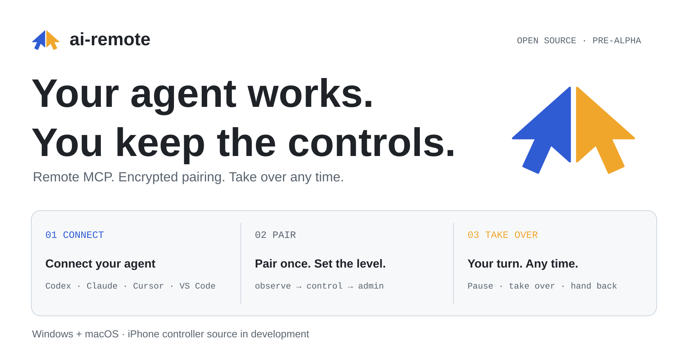
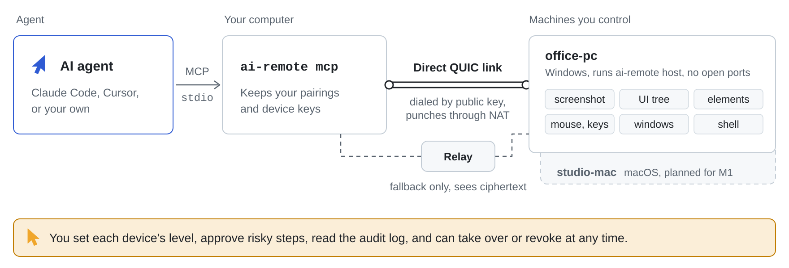

# ai-remote

<p align="right"><b>English</b> · <a href="README.zh-CN.md">中文</a></p>
<p align="center"><picture>
<source media="(prefers-color-scheme: dark)" srcset="assets/brand/home-dark.svg">
<source media="(prefers-color-scheme: light)" srcset="assets/brand/home-light.svg">

</picture></p>
<p align="center"><a href="#across-your-devices">Platforms</a> · <a href="#paired-devices-connected-over-p2p">P2P</a> · <a href="#ai-native-from-protocol-to-control">AI Native</a> · <a href="#start-from-source">Get started</a> · <a href="#connect-your-agent">MCP setup</a> · <a href="https://mcpservers.org/servers/jia-ss/ai-remote">MCP listing</a> · <a href="docs/architecture.md">Architecture</a></p>

<p align="center">
<a href="https://mcpservers.org/servers/jia-ss/ai-remote"></a>
<a href="https://m8ven.ai/mcp/jia-ss-ai-remote-orb00i?s=readme"></a>
</p>

**AI-native remote control across your devices, over encrypted P2P.**
Your phone, your tablet, your Mac, your PC — and your AI agent, connected through one shared control layer. Use the human apps to view and control your paired computers, or connect your existing MCP agent to do the work. Watch the screen, take over, and hand control back whenever you want.

**Mac + Windows implemented · iOS / iPhone WIP · iPadOS / iPad WIP · Android WIP · Linux WIP**

## Across your devices

| Platform | Role | Status |
| :-- | :-- | :-- |
| **macOS / Mac** | Host + desktop controller | Implemented; local Apple Silicon pairing, capture, input and H.264 stream acceptance. [Mac setup](docs/macos.md) |
| **Windows / PC** | Host + desktop controller | Implemented; Windows UIA and native input paths. [Operations](docs/operations.md) · [Structured UI evidence](docs/structured-ui.md) |
| **iOS / iPhone** | Native mobile controller | **WIP** — SwiftUI/UniFFI source, device/simulator SDK builds and simulator UI tests; physical remote-control acceptance pending. [Validation](docs/iphone-validation.md) |
| **iPadOS / iPad** | Tablet controller | **WIP** — adaptive iPad layout prioritizes the 12.9-inch iPad Pro, with simulator coverage in CI; physical-device and system multitasking acceptance pending. [Source and builds](apps/ios/README.md) |
| **Android** | Phone / tablet controller | **WIP** — planned; native app implementation pending. |
| **Linux** | Desktop host / controller | **WIP** — desktop support and platform acceptance pending. |

Mobile devices are **controllers for your computers**. The project does not currently host a remotely controlled iPhone, iPad or Android device. Linux is a development target, not a supported desktop today.

> [!NOTE]
> **Pre-alpha; build from source.** No signed release or App Store app is available. Mac acceptance used Apple Silicon and macOS 27; Intel Macs and older systems need runtime checks. Platform implementation, SDK builds and simulator tests have different validation scopes. See [Mac evidence](docs/macos.md), [Windows/Mac UI evidence](docs/structured-ui.md) and [iPhone validation](docs/iphone-validation.md).

## Paired devices, connected over P2P

**Computer to computer. Phone or tablet to computer. Your agent to your paired hosts.**
The desktop apps, experimental iOS controller and MCP bridge share the Rust controller and encrypted QUIC transport. Pair by device identity, then reach the computers you trust — whether you drive them yourself or hand the tools to your agent.

- **P2P first.** NAT hole punching attempts a direct device-to-device path. If a direct path is unavailable, an encrypted relay carries the traffic; it sees ciphertext.
- **Pair once, keep trust.** One-time tickets and a matching safety code establish device identity. A fresh connection reattempts connectivity; pairing does not promise a permanent direct path.
- **No manual port forwarding or project cloud account in normal setup.** Restrictive networks can still prevent a connection. Self-hosted relays can be configured on the host. [Transport architecture](docs/architecture.md)

<p align="center"><picture>
<source media="(prefers-color-scheme: dark)" srcset="assets/brand/how-it-works-dark.svg">
<source media="(prefers-color-scheme: light)" srcset="assets/brand/how-it-works-light.svg">

</picture></p>

## AI-native, from protocol to control

**Bring the agent you already use: Codex, Claude Code, Cursor, VS Code, or any stdio MCP client.** One MCP bridge exposes your paired computers as tools; no ai-remote hosted model is required.

| Capability | What your agent can do |
| :-- | :-- |
| **Native MCP** | Discover and call remote tools through the local stdio bridge; reach multiple paired hosts from one client configuration. [Client setup](docs/mcp-clients.md) |
| **Structured UI** | Read native macOS AX / Windows UIA trees and act on elements with `ui_tree`, `ui_read` and `ui_action`, alongside screenshots. [UI contracts](docs/structured-ui.md) |
| **Computer tools** | Capture screens, inspect windows, send mouse/keyboard input, run shell/background jobs and copy files at the permitted access level, from an agent or straight from a terminal (`ai-remote exec`, `job`, `shot`, `push`, `pull`). [Tools](docs/tools.md) · [Command line](docs/operations.md#41-operating-a-host-from-the-command-line) |
| **Shared human / agent control** | Watch live video and activity. Taking over stops agent control calls; handing back lets the agent resume. [Control and approvals](docs/approvals.md) |
| **Extensible integrations** | Mount existing local MCP servers with a pinned executable and an explicit tool allowlist. |

The host checks access level, turn, policy and approval before executing tools. You decide which computers the agent can reach and what it can do on each one.

Desktop stream presets request 1080p30, 1080p60 or 4K30 and show actual decoded resolution/frame rate and received bitrate. macOS 13+ uses native ScreenCaptureKit and VideoToolbox hardware encoding (HEVC or H.264 High, the display's refresh rate, up to 8K for HEVC), with software fallback. [Measurements and limits](docs/stream-performance.md) separate encoder benchmarks from live remote performance; presets are requested limits, not guaranteed throughput.

## Start from source

You need the pinned Rust toolchain (1.95.0). The desktop app also needs Node/npm and the platform's native development tools.

```sh
git clone https://github.com/JIA-ss/ai-remote.git
cd ai-remote
cargo install --path crates/ai-remote --locked
```

On **macOS**, build and open a development app with its CLI included:

```sh
tools/macos.sh build --debug --bundles app
open target/debug/bundle/macos/ai-remote.app
```

On the **computer to control**, run the installed CLI (make sure Cargo’s bin directory is on PATH):

```sh
ai-remote host
# In another terminal on that computer (or in the desktop app: This device → Show pair code):
ai-remote pair-code --level control
```

It shows a QR code and an eight-digit pair code. Scan the QR code with the iPhone app, or type the
digits on the **controller computer** (the desktop app's Pair a computer page, or the CLI):

```sh
ai-remote pair 4821 0937 --name office-pc
ai-remote call system_info --host office-pc
```

Compare the same three-word safety code on both devices. On a Mac host, grant Screen Recording and Accessibility to the actual running executable, restart it, and run `ai-remote doctor`. A locked or unauthorized desktop must be repaired before capture/input, not worked around. [Detailed operations](docs/operations.md)

## Connect your agent

**Discover, then connect.** Explore [ai-remote on mcpservers.org](https://mcpservers.org/servers/jia-ss/ai-remote) for the public MCP profile, then configure your client below to reach your own paired computers.

In the desktop app, open **Settings → Agents**, choose your MCP client, then copy its setup. The app supplies the actual executable path and the current pairing profile, including when the CLI lives inside the Mac bundle.

If `ai-remote` is on PATH, the basic commands are:

```sh
# Claude Code, available across your projects
claude mcp add --transport stdio --scope user ai-remote -- ai-remote mcp
# Codex
codex mcp add ai-remote -- ai-remote mcp
```

Cursor uses `mcpServers` JSON in `~/.cursor/mcp.json`. VS Code uses `servers` JSON in its MCP configuration. Codex also supports `[mcp_servers.ai-remote]` in `~/.codex/config.toml`. Paths, quoting and exact examples: [MCP client setup](docs/mcp-clients.md).

Then give the agent the working method: [skills/ai-remote/SKILL.md](skills/ai-remote/SKILL.md) tells it how to start a session, look, act, run commands and files, and what levels, approvals, refusals and the owner taking over mean. Copy the folder to `~/.claude/skills/` for Claude Code, or paste it into any other agent's rules.

## Your computers, your rules

| Level | Allowed tools |
| :-- | :-- |
| `observe` | Screen, window list, system info and permitted read-only integrations |
| `control` | Observe plus mouse, keyboard and clipboard |
| `admin` | Control plus shell, background jobs and files; risky calls ask first |

High-risk steps wait for owner approval. An unanswered request is denied. Every decision and outcome goes to the host's audit log. Revoke/unpair a device to remove its access. On a machine you only drive yourself, **bypass** (set at that machine: `ai-remote bypass on <controller>` or the app's device settings) trusts chosen controllers with everything: every tool, no approvals. [Bypass](docs/operations.md#61-bypass-trusting-a-controller-with-everything)

**Allowing remotely currently requires Windows Hello.** Mac and iPhone controllers can deny; their Touch ID / Face ID signing backends are not implemented. The native host prompt remains an approval path when the host's desktop is usable. [Approval design](docs/approvals.md)

## Questions people ask

**Can my iPhone control my computer?** That is the purpose of `apps/ios`: native SwiftUI UI over the shared Rust controller. The source includes pairing, video, touch/text, takeover and activity. Device and arm64 simulator builds pass with the iOS SDK, as do simulator startup, invalid-ticket, background/resume and relaunch tests. Live control on a physical iPhone still needs acceptance.

**Can an agent control my iPhone through this app?** No. The iOS source is a controller, not an iPhone host.

**Do I need port forwarding or an ai-remote cloud account?** No manual port-forwarding or project cloud account is part of normal pairing. Network restrictions can still make a peer unreachable; the tool reports that rather than guaranteeing every network works.

**Does it include a native accessibility tree or file manager?** The core includes native Mac AX and Windows UIA trees and element actions, alongside screenshots, input and windows. See [structured UI contracts and acceptance](docs/structured-ui.md). File transfer remains planned.

**Where are the binaries?** No signed release is published yet. Build from source; Windows, Intel Mac, iPhone signing and notarization have separate verification needs.

## Development and evidence

```sh
cargo test --workspace
cargo clippy --workspace --all-targets -- -D warnings
node --test tools/mcp-install.test.mjs
```

[Mac acceptance](docs/macos.md) · [iPhone validation ledger](docs/iphone-validation.md) · [Tool reference](docs/tools.md) · [Security](SECURITY.md) · [Contributing](CONTRIBUTING.md)

## Roadmap

| Stage | Next work |
| :-- | :-- |
| M0–M2 | Continue Windows/Mac acceptance, improve capture performance, complete file/accessibility work and signed packaging |
| M3 | Mobile controllers: iOS/iPhone and iPadOS/iPad acceptance, Android implementation; Face ID signing, QR pairing and notifications |
| Platform expansion | Linux desktop host/controller support and acceptance |
| M4 | Optional self-hosted account/relay services and device sharing |

## License

[AGPL-3.0](LICENSE). The official project is [JIA-ss/ai-remote](https://github.com/JIA-ss/ai-remote).
