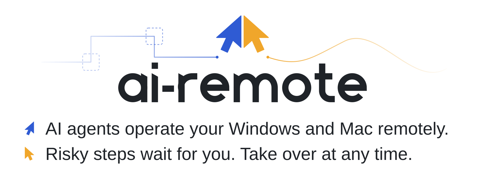

<p align="right"><b>English</b>&nbsp;&nbsp;|&nbsp;&nbsp;<a href="README.zh-CN.md">中文</a></p>

<p align="center">
  <picture>
    <source media="(prefers-color-scheme: dark)" srcset="assets/brand/banner-dark.svg">
    <source media="(prefers-color-scheme: light)" srcset="assets/brand/banner-light.svg">
    
  </picture>
</p>

<p align="center">
  <a href="#quickstart">Quickstart</a>&nbsp;&nbsp;&nbsp;
  <a href="#how-it-works">How&nbsp;it&nbsp;works</a>&nbsp;&nbsp;&nbsp;
  <a href="#you-stay-in-charge">Safety</a>&nbsp;&nbsp;&nbsp;
  <a href="#roadmap">Roadmap</a>
</p>

ai-remote lets the AI agent you already use operate your other computers. Run a small host on the Windows PC or Mac you want to control and pair it with your own machine once. From then on, any MCP agent (Claude Code, Cursor, or one you wrote) can see the screen, read each window as a tree of named elements, and act on those elements. Your devices connect directly over an encrypted peer-to-peer link. You decide what each device allows, approve anything risky, and can take over at any moment.

> [!NOTE]
> **Pre-alpha.** Milestone M0 (CLI, Windows host, MCP bridge) is implemented and being tested, and the M2 desktop app is taking shape: live video, approvals from your own device with Windows Hello, and taking turns with the agent. Nothing is released yet, it is not ready for real machines, and commands may change. Star or watch the repository to follow along, or open an issue to help shape the design.

<p align="center">
  <picture>
    <source media="(prefers-color-scheme: dark)" srcset="assets/brand/demo-dark.svg">
    <source media="(prefers-color-scheme: light)" srcset="assets/brand/demo-light.svg">
    
  </picture>
  <br>
  <sub>Blue is the agent, amber is you. An illustration of the planned flow: the live view comes with the desktop app in M2, and the interface is not final.</sub>
</p>

## What is different

| Usually | With ai-remote |
| :-- | :-- |
| The agent looks at a screenshot and guesses where to click. | The agent reads the accessibility tree and acts on elements by reference, such as <code>click&nbsp;e4</code>. That keeps working when a window moves, scales, or changes theme. Screenshots, mouse, and keyboard stay available as a fallback. |
| To reach a machine, you open a port, run a VPN, or rent a tunnel. | Devices dial each other by public key over QUIC, built on iroh, and punch through NAT. When there is no direct path, an encrypted relay forwards traffic it cannot read. |
| Remote access is all or nothing. | Each paired device has a level: observe, control, or admin. Risky actions wait for your approval, and every action lands in an audit log. |
| A vendor's cloud sits between you and your machines. | Your devices talk peer to peer and pair with a one-time ticket. An optional account service is planned, and you will be able to host it yourself. |

### What the agent sees

A window arrives as a compact tree. Each element has a role, a name, and a reference the agent acts on. This is the window from the demo:

```text
e1  window "Q3 report"
e2  ├─ button "Open"
e3  ├─ button "Save"
e4  ├─ button "Export PDF"
e5  ├─ button "Share"
e6  ├─ heading "Q3 report"
e7  └─ table "Key figures"
e8     ├─ cell "$4.2M"
e9     └─ cell "2.4%"
```

To export, the agent calls `click e4`. The host finds that button wherever it is on screen and presses it.

<sub>Illustrative. Tool names and the tree format will settle during M0.</sub>

## How it works

<p align="center">
  <picture>
    <source media="(prefers-color-scheme: dark)" srcset="assets/brand/how-it-works-dark.svg">
    <source media="(prefers-color-scheme: light)" srcset="assets/brand/how-it-works-light.svg">
    
  </picture>
</p>

1. **`ai-remote host`** runs on each machine you want to control. It offers that machine's screen, input, windows, clipboard, shell, and background jobs as MCP tools, plus the tools of local MCP servers you mount, such as an accessibility-tree driver for element-level UI actions (file tools come in M1). It checks every call against the device's level and writes the audit log.
2. **`ai-remote mcp`** runs next to your agent and bridges it to every host you have paired. A desktop app and an iOS app come later.
3. The two ends find each other by public key and talk over QUIC. The relay is only a fallback and cannot read the traffic.

The full design is in [docs/architecture.md](docs/architecture.md). It is also available in [Chinese](docs/architecture.zh-CN.md). Every tool an agent gets, with its parameters and limits, is described in [docs/tools.md](docs/tools.md).

## Quickstart

> [!WARNING]
> There are no releases yet. These are the planned M0 commands, and they may change before the first release.

**1. On the machine you want the agent to operate**, start the host. Then, in a second terminal, print a one-time pairing ticket:

```sh
ai-remote host
ai-remote pair-code
```

**2. On your own computer**, pair with that ticket and give the machine a name:

```sh
ai-remote pair <ticket> --name office-pc
```

**3. Add the bridge to your agent.** For Claude Code:

```sh
claude mcp add ai-remote -- ai-remote mcp
```

Any MCP client that can start a stdio server works the same way: point it at `ai-remote mcp`.
The desktop app shows setup for Claude Code, Codex, Cursor and VS Code, including the actual bundled
CLI path; see [MCP client setup](docs/mcp-clients.md).

To start the host at logon, check a machine with `ai-remote doctor`, or find out why a call was refused, see [docs/operations.md](docs/operations.md).

### What you can ask for

- *"On office-pc, export the Q3 report as a PDF and share it with Finance."*
- *"Open the build log on lab-box and tell me why last night's job failed."*
- *"Check office-pc for pending Windows updates and install them, but ask me before it restarts."*
- *"Take a screenshot of office-pc and tell me which windows are open."*

## You stay in charge

ai-remote treats the agent as a guest on your machine. The owner sets the rules, and the host enforces them.

| Level | The agent can |
| :-- | :-- |
| `observe` | See the screen, read the UI tree, list windows |
| `control` | Everything in `observe`, plus act on elements and use mouse and keyboard |
| `admin` | Everything in `control`, plus run shell commands and work with files |

Give each device the lowest level that does the job: `observe` to ask about the screen, `control` to operate apps, `admin` for setup and maintenance.

- **Approvals.** Risky actions, such as a shell command that deletes files, pause until the owner approves or denies them: in a native prompt on the host, or from a paired device, where allowing needs Windows Hello so an agent can never approve its own request ([how it works](docs/approvals.md)). No answer in time means no. Approval cards in the desktop app and on your phone come next.
- **Audit log.** Every action is recorded with who did it, what it touched, and the result.
- **Take over and revoke.** You can take the controls back at any moment, and unpair a device to cut its access completely.
- **Pairing and encryption.** Devices pair with a one-time ticket and are identified by their keys. Traffic is end-to-end encrypted, including when it passes through a relay.

These are the default levels and may be refined before the first release.

## Roadmap

| Milestone | What ships | Status |
| :-- | :-- | :-- |
| **M0** | CLI, Windows host, MCP bridge | Implemented, not released |
| **M1** | macOS host, file tools | In progress: basic Mac host and native controller adaptation; file tools pending ([development and validation](docs/macos.md)) |
| **M2** | Desktop app with live view and approvals | In progress: live video, remote approvals, take over / hand back, the app's main screens |
| **M3** | iOS controller app on the App Store | Planned |
| **M4** | Optional account service, self-hosted relay | Planned |

Hosts come to Windows first, then macOS. On the controlling side, the CLI comes first, then a desktop app and an iOS app.

## Contributing

The architecture is still settling, so design feedback is the most useful contribution right now. Read [docs/architecture.md](docs/architecture.md), then open an [issue](https://github.com/JIA-ss/ai-remote/issues) with questions, use cases, or objections. Code contributions open later; [CONTRIBUTING.md](CONTRIBUTING.md) describes how they will work. Please report security problems privately, as described in [SECURITY.md](SECURITY.md).

## License

[AGPL-3.0](LICENSE)

<p align="center">
  <br>
  <picture>
    <source media="(prefers-color-scheme: dark)" srcset="assets/brand/logo-dark.svg">
    <source media="(prefers-color-scheme: light)" srcset="assets/brand/logo-light.svg">
    
  </picture>
</p>
