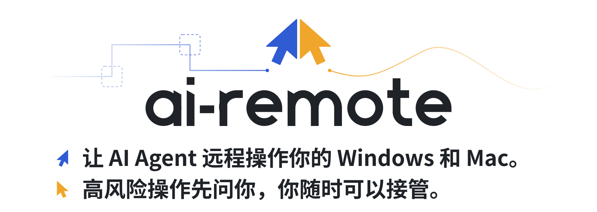

<p align="right"><a href="README.md">English</a>&nbsp;&nbsp;|&nbsp;&nbsp;<b>中文</b></p>

<p align="center">
  <picture>
    <source media="(prefers-color-scheme: dark)" srcset="assets/brand/banner-dark.zh-CN.svg">
    <source media="(prefers-color-scheme: light)" srcset="assets/brand/banner-light.zh-CN.svg">
    
  </picture>
</p>

<p align="center">
  <a href="#快速上手">快&#8288;速&#8288;上&#8288;手</a>&nbsp;&nbsp;&nbsp;&nbsp;
  <a href="#工作原理">工&#8288;作&#8288;原&#8288;理</a>&nbsp;&nbsp;&nbsp;&nbsp;
  <a href="#控制权始终在你手里">安&#8288;全&#8288;机&#8288;制</a>&nbsp;&nbsp;&nbsp;&nbsp;
  <a href="#路线图">路&#8288;线&#8288;图</a>
</p>

ai-remote 让你正在用的 AI Agent 直接操作你的其他电脑。在想要控制的 Windows 或 Mac 上运行一个轻量的被控端，和自己的电脑配对一次。之后，任何支持 MCP 的 Agent（Claude Code、Cursor，或者你自己写的）都能看到屏幕，把每个窗口读成一棵带名字的元素树，并直接操作这些元素。设备之间通过加密的点对点链路直连。每台设备允许做什么由你决定，高风险操作要经过你批准，你也随时可以接管。

> [!NOTE]
> **Pre-alpha 阶段**。第一个里程碑 M0（命令行、Windows 被控端、MCP 桥接）正在开发中。目前还没有发布任何版本，不能用在真实的机器上，命令也可能会变。欢迎 Star 或 Watch 关注进展，也欢迎提 issue 一起讨论设计。

<p align="center">
  <picture>
    <source media="(prefers-color-scheme: dark)" srcset="assets/brand/demo-dark.zh-CN.svg">
    <source media="(prefers-color-scheme: light)" srcset="assets/brand/demo-light.zh-CN.svg">
    
  </picture>
  <br>
  <sub>蓝色是 Agent，琥珀色是你。这是规划中流程的示意：实时画面要等 M2 的桌面应用，界面也还没有定稿。</sub>
</p>

## 有什么不同

| 通常 | 用 ai-remote |
| :-- | :-- |
| Agent 盯着截图，猜该点哪里。 | Agent 读取系统的无障碍（accessibility）界面树，按引用操作元素，比如 <code>click&nbsp;e4</code>。窗口移动、缩放或者换主题都不受影响。截图和鼠标键盘输入仍然保留，作为兜底。 |
| 想连上一台机器，得开端口、搭 VPN，或者买内网穿透服务。 | 设备之间按公钥互相拨号，用基于 iroh 的 QUIC 连接，自动打洞穿透 NAT；实在打不通时才走加密中继，中继只能看到密文。 |
| 远程权限要么全给，要么不给。 | 每台配对设备都有自己的权限级别：observe、control 或 admin。高风险操作要等你批准，每个操作都会写进审计日志。 |
| 厂商的云服务挡在你和你的机器之间。 | 设备之间点对点通信，用一次性票据配对。可选的账号服务还在规划中，到时候也能自己部署。 |

### Agent 看到的界面

窗口会以一棵精简元素树的形式交给 Agent。每个元素都有角色、名称和一个引用，Agent 就靠这个引用来操作它。下面是演示里的那个窗口：

```text
e1  window "Q3 报告"
e2  ├─ button "打开"
e3  ├─ button "保存"
e4  ├─ button "导出 PDF"
e5  ├─ button "分享"
e6  ├─ heading "Q3 报告"
e7  └─ table "关键指标"
e8     ├─ cell "$4.2M"
e9     └─ cell "2.4%"
```

要导出 PDF，Agent 只需调用 `click e4`。不管这个按钮此刻在屏幕的哪个位置，被控端都会找到它并按下去。

<sub>仅作示意，工具名和树的格式会在 M0 期间确定。</sub>

## 工作原理

<p align="center">
  <picture>
    <source media="(prefers-color-scheme: dark)" srcset="assets/brand/how-it-works-dark.zh-CN.svg">
    <source media="(prefers-color-scheme: light)" srcset="assets/brand/how-it-works-light.zh-CN.svg">
    
  </picture>
</p>

1. **`ai-remote host`** 运行在每台要被控制的机器上，也就是被控端。它把这台机器的屏幕、界面树、输入、窗口和 shell 以 MCP 工具的形式提供出来（文件工具在 M1 推出），按设备的权限级别检查每一次调用，并写入审计日志。
2. **`ai-remote mcp`** 运行在 Agent 旁边，是控制端，负责把 Agent 和你配对过的所有被控端连起来。桌面应用和 iOS 应用会在之后推出。
3. 两端按公钥找到彼此，用 QUIC 通信。中继只是兜底，读不到传输的内容。

完整设计见 [docs/architecture.zh-CN.md](docs/architecture.zh-CN.md)，也有[英文版](docs/architecture.md)。

## 快速上手

> [!WARNING]
> 目前还没有发布版本。以下是 M0 规划中的命令，正式发布前可能会变。

**1. 在要让 Agent 操作的机器上**启动被控端，然后在另一个终端里生成一次性配对票据：

```sh
ai-remote host
ai-remote pair-code
```

**2. 在你自己的电脑上**用这张票据完成配对，并给这台机器起个名字：

```sh
ai-remote pair <ticket> --name office-pc
```

**3. 把桥接加到你的 Agent 里**。以 Claude Code 为例：

```sh
claude mcp add ai-remote -- ai-remote mcp
```

其他能启动 stdio 服务的 MCP 客户端也一样，指向 `ai-remote mcp` 即可。

### 可以让它做什么

- “在 office-pc 上把 Q3 报告导出成 PDF，再分享给财务组。”
- “打开 lab-box 上的构建日志，告诉我昨晚的任务为什么失败。”
- “看看 office-pc 有没有待安装的 Windows 更新，有就装上，重启之前先问我。”
- “给 office-pc 截个图，告诉我现在开着哪些窗口。”

## 控制权始终在你手里

在 ai-remote 里，Agent 是你机器上的客人：规则由机主定，由被控端执行。

| 级别 | Agent 能做什么 |
| :-- | :-- |
| `observe` | 看屏幕、读界面树、列出窗口 |
| `control` | `observe` 的全部能力，外加操作界面元素、使用鼠标键盘 |
| `admin` | `control` 的全部能力，外加执行 shell 命令、读写文件 |

每台设备只给够用的最低级别：查看屏幕给 `observe`，操作应用给 `control`，安装和维护才给 `admin`。

- **审批**：高风险操作（比如会删除文件的 shell 命令）会先暂停，等机主批准或拒绝。审批界面计划在 M1 推出。
- **审计日志**：每个操作都会记下是谁做的、动了什么、结果如何。
- **接管与撤销**：你随时可以收回控制权，解除配对就能彻底切断这台设备的访问。
- **配对与加密**：设备用一次性票据配对，以各自的密钥识别身份。流量端到端加密，经过中继时也一样。

以上权限级别是规划中的默认设置，M0 和 M1 期间可能还会调整。

## 路线图

| 里&#8288;程&#8288;碑 | 交付内容 | 状&#8288;态 |
| :-- | :-- | :-- |
| **M0** | 命令行、Windows 被控端、MCP 桥接 | 进&#8288;行&#8288;中 |
| **M1** | macOS 被控端、文件工具、审批界面 | 计&#8288;划&#8288;中 |
| **M2** | 供人查看的实时画面、桌面应用 | 计&#8288;划&#8288;中 |
| **M3** | iOS 控制端（上架 App Store） | 计&#8288;划&#8288;中 |
| **M4** | 可选的账号服务、可自建的中继 | 计&#8288;划&#8288;中 |

被控端先支持 Windows，再支持 macOS。控制端先做命令行，之后是桌面应用和 iOS 应用。

## 参与贡献

架构还在定型，现阶段最有价值的贡献是设计上的反馈。建议先读 [docs/architecture.zh-CN.md](docs/architecture.zh-CN.md)，再到 [issue](https://github.com/JIA-ss/ai-remote/issues) 里提问题、讲使用场景，或者提出反对意见。代码贡献之后才会开放，具体流程见 [CONTRIBUTING.md](CONTRIBUTING.md#参与贡献)。安全问题请按 [SECURITY.md](SECURITY.md) 里的方式私下报告。

## 许可证

[AGPL-3.0](LICENSE)

<p align="center">
  <br>
  <picture>
    <source media="(prefers-color-scheme: dark)" srcset="assets/brand/logo-dark.svg">
    <source media="(prefers-color-scheme: light)" srcset="assets/brand/logo-light.svg">
    
  </picture>
</p>
