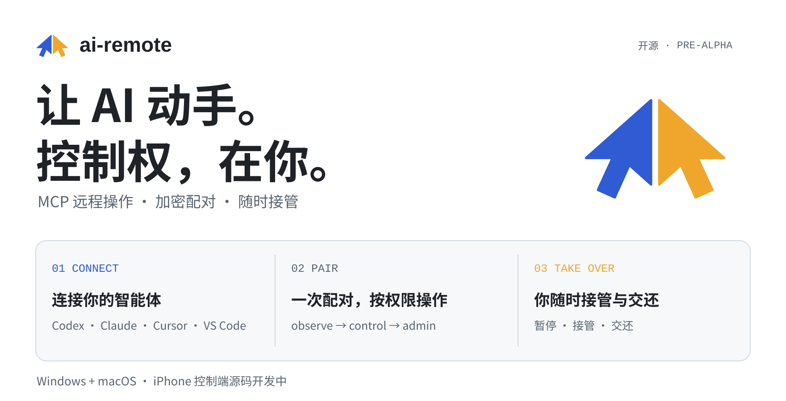
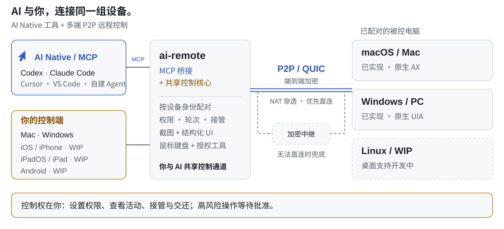

# ai-remote

<p align="right"><a href="README.md">English</a> · <b>中文</b></p>
<p align="center"><picture>
<source media="(prefers-color-scheme: dark)" srcset="assets/brand/home-dark.zh-CN.svg">
<source media="(prefers-color-scheme: light)" srcset="assets/brand/home-light.zh-CN.svg">

</picture></p>
<p align="center"><a href="#连接你的每一端">平台支持</a> · <a href="#多端-p2p-加密连接">P2P 直连</a> · <a href="#ai-native从协议到控制">AI Native</a> · <a href="#从源码开始">快速上手</a> · <a href="#接入你的智能体">MCP 接入</a> · <a href="docs/architecture.zh-CN.md">架构</a></p>

**AI Native 多端远程控制，P2P 加密连接你的设备。**
手机、平板、Mac、PC，与你的 AI，共用一套远程控制核心。通过控制端查看和操作已配对的电脑，也可以接入现有 MCP 智能体，让 AI 动手。你看得见屏幕和操作过程，随时接管，再把控制权交还给 AI。

**Mac + Windows 已实现 · iOS / iPhone WIP · iPadOS / iPad WIP · Android WIP · Linux WIP**

## 连接你的每一端

| 平台 | 角色 | 状态 |
| :-- | :-- | :-- |
| **macOS / Mac** | 被控端 + 桌面控制端 | 已实现；Apple Silicon 本机已验证配对、截图、输入与 H.264 屏幕流。[Mac 配置](docs/macos.md) |
| **Windows / PC** | 被控端 + 桌面控制端 | 已实现；包含 Windows UIA 与原生输入路径。[使用说明](docs/operations.zh-CN.md) · [结构化 UI 验收](docs/structured-ui.md) |
| **iOS / iPhone** | 原生手机控制端 | **WIP** — 已有 SwiftUI/UniFFI 源码，设备/模拟器 SDK 构建和模拟器界面测试通过；真机远控待验收。[验收记录](docs/iphone-validation.md) |
| **iPadOS / iPad** | 平板控制端 | **WIP** — iOS 应用已声明支持 iPhone 与 iPad；iPad 布局与真机验收待完成。[源码与构建](apps/ios/README.md) |
| **Android** | 手机 / 平板控制端 | **WIP** — 规划中，原生应用待实现。 |
| **Linux** | 桌面被控端 / 控制端 | **WIP** — 桌面能力与平台验收待完成。 |

移动设备的角色是**控制你的电脑**，目前不提供远程操作 iPhone、iPad 或 Android 设备的被控端。Linux 是开发目标，尚不是已支持的桌面平台。

> [!NOTE]
> **Pre-alpha，需要从源码构建。** 暂无签名发行包或 App Store 应用。Mac 验收使用 Apple Silicon 与 macOS 27；Intel Mac 和较早系统需要独立验证。已有实现、SDK 构建与模拟器测试各有不同的验证范围，见 [Mac 证据](docs/macos.md)、[Windows/Mac UI 证据](docs/structured-ui.md)与 [iPhone 验收记录](docs/iphone-validation.md)。

## 多端 P2P 加密连接

**电脑控制电脑，手机或平板控制电脑，AI 操作已配对的远端。**
桌面应用、实验性 iOS 控制端与 MCP 桥接复用 Rust 控制核心和加密 QUIC 传输。按设备身份配对，连接你信任的电脑；你亲自操作与 AI 调用工具，都走同一套连接与权限机制。

- **P2P 优先直连。** 通过 NAT 打洞尝试设备间直接连接；无法直连时使用加密中继兜底，中继只能看到密文。
- **配对保留信任关系。** 一次性票据与两端一致的安全码确认身份。新连接会重新尝试连通路径，配对不代表永久直连。
- **正常使用无需手动端口转发或项目云账号。** 受限网络仍可能导致不可达；被控端可配置自托管中继。[传输架构](docs/architecture.zh-CN.md)

<p align="center"><picture>
<source media="(prefers-color-scheme: dark)" srcset="assets/brand/how-it-works-dark.zh-CN.svg">
<source media="(prefers-color-scheme: light)" srcset="assets/brand/how-it-works-light.zh-CN.svg">

</picture></p>

## AI Native：从协议到控制

**沿用你已有的 Codex、Claude Code、Cursor、VS Code 或任意 stdio MCP 客户端。** 一个 MCP 桥接，把已配对的电脑变成智能体可调用的工具；无需项目自带的托管 AI 模型。

| 能力 | AI 能做什么 |
| :-- | :-- |
| **原生 MCP 接入** | 通过本地 stdio 桥接发现和调用远端工具；一份客户端配置访问多台已配对电脑。[客户端配置](docs/mcp-clients.md) |
| **结构化 UI** | 使用 `ui_tree`、`ui_read`、`ui_action` 读取 macOS AX / Windows UIA 元素树并操作控件，也保留截图能力。[UI 合约](docs/structured-ui.md) |
| **电脑工具** | 查看屏幕、检查窗口、发送鼠标键盘输入，按权限运行 shell 与后台任务、传输文件；Agent 能用，终端里也能直接用（`ai-remote exec`、`job`、`shot`、`push`、`pull`）。[工具参考](docs/tools.zh-CN.md) · [命令行](docs/operations.zh-CN.md#41-用命令行操作被控端) |
| **人机共享控制** | 你查看实时画面与活动记录；接管时阻止智能体控制调用，交还后恢复。[控制与审批](docs/approvals.zh-CN.md) |
| **扩展现有集成** | 指定本地可执行文件与工具白名单，挂载已有 MCP 服务。 |

每次执行都由被控端检查权限、轮次、策略与审批。AI 能访问哪些电脑、每台电脑允许哪些操作，由你决定。

桌面屏幕流预设可请求 1080p30、1080p60 或 4K30，并显示实际解码分辨率、帧率和接收码率。macOS 13+ 使用原生 ScreenCaptureKit 与 VideoToolbox 硬件编码，保留软件回退。[性能证据与限制](docs/stream-performance.md)区分编码基准与真实远控表现；预设是请求上限，不是吞吐保证。

## 从源码开始

需要锁定的 Rust 1.95.0 工具链。桌面应用还需要 Node/npm 与对应系统的原生开发工具。

```sh
git clone https://github.com/JIA-ss/ai-remote.git
cd ai-remote
cargo install --path crates/ai-remote --locked
```

在 **macOS** 构建带 CLI 的开发应用：

```sh
tools/macos.sh build --debug --bundles app
open target/debug/bundle/macos/ai-remote.app
```

在**被控电脑**上运行安装后的 CLI（确保 Cargo 的 bin 目录已加入 PATH）：

```sh
ai-remote host
# 在这台电脑的另一终端生成票据：
ai-remote pair-code --level control
```

在**控制电脑**兑换一次性票据：

```sh
ai-remote pair <ticket> --name office-pc
ai-remote call system_info --host office-pc
```

核对两端相同的三个单词安全码。Mac 被控端需要给实际运行的可执行文件授予屏幕录制与辅助功能权限，重启后运行 `ai-remote doctor`。锁屏或权限不足时，先恢复桌面和权限再操作。[详细说明](docs/operations.zh-CN.md)

## 接入你的智能体

桌面应用中打开 **设置 → 智能体**，选择客户端后复制安装指引。应用会提供真实可执行文件路径和当前配对配置目录，也支持 Mac 应用包内的 CLI。

CLI 已加入 PATH 时，可使用：

```sh
# Claude Code，适用于所有项目
claude mcp add --transport stdio --scope user ai-remote -- ai-remote mcp
# Codex
codex mcp add ai-remote -- ai-remote mcp
```

Cursor 使用 `~/.cursor/mcp.json` 中的 `mcpServers` JSON，VS Code 使用 MCP 配置中的 `servers` JSON。Codex 还可在 `~/.codex/config.toml` 中添加 `[mcp_servers.ai-remote]`。路径、转义和完整示例见 [MCP 客户端配置](docs/mcp-clients.md)。

## 你的电脑，你的规则

| 等级 | 允许的工具 |
| :-- | :-- |
| `observe` | 屏幕、窗口列表、系统信息与已允许的只读集成 |
| `control` | observe 加鼠标、键盘与剪贴板 |
| `admin` | control 加 shell、后台任务与文件；高风险调用先等待批准 |

高风险请求等待主人确认，未响应则拒绝。每次决策与结果写入被控端审计日志；撤销或取消配对即可移除设备访问权。只由你自己操作的电脑，可以开 **bypass**（在那台电脑上设置：`ai-remote bypass on <控制端>` 或桌面应用的本设备设置），完全信任选定的控制端：全部工具、无需审批。[Bypass](docs/operations.zh-CN.md#61-bypass完全信任某台控制端)

**远程允许签名当前需要 Windows Hello。** Mac 与 iPhone 控制端可以拒绝；Touch ID / Face ID 允许签名尚未实现。被控电脑桌面可用时，也可通过本机提示批准。[审批设计](docs/approvals.zh-CN.md)

## 常见问题

**iPhone 能控制电脑吗？** `apps/ios` 就是为此开发的原生 SwiftUI 控制端，复用 Rust 核心，包含配对、画面、触控与文字、接管和活动功能。设备与 arm64 模拟器已通过 iOS SDK 编译，模拟器启动、无效票据、后台恢复和重新启动测试也已通过。iPhone 真机上的实时控制仍待验收。

**智能体能通过它控制 iPhone 吗？** 不能。iOS 源码是控制端，不是 iPhone 被控端。

**需要端口转发或 ai-remote 云账号吗？** 正常配对不要求手动端口转发或项目云账号。网络限制仍可能使设备不可达，工具会返回错误，不保证所有网络都能连接。

**自带原生无障碍元素树或文件管理吗？** 核心已包含 Mac AX 与 Windows UIA 元素树及元素动作，同时保留截图、输入和窗口工具。见[结构化 UI 合约与验收](docs/structured-ui.md)。文件传输仍在规划中。

**安装包在哪里？** 暂未发布签名版本，需要从源码构建。Windows、Intel Mac、iPhone 签名与 Mac 公证都有各自的验收要求。

## 开发与证据

```sh
cargo test --workspace
cargo clippy --workspace --all-targets -- -D warnings
node --test tools/mcp-install.test.mjs
```

[Mac 验收](docs/macos.md) · [iPhone 验收记录](docs/iphone-validation.md) · [工具参考](docs/tools.zh-CN.md) · [安全策略](SECURITY.md) · [参与贡献](CONTRIBUTING.md)

## 路线图

| 阶段 | 下一步 |
| :-- | :-- |
| M0–M2 | 持续验证 Windows/Mac，提升捕获性能，完成文件与无障碍能力，签名打包 |
| M3 | 移动控制端：iOS/iPhone 与 iPadOS/iPad 验收、Android 实现；Face ID 签名、二维码配对与通知 |
| 平台扩展 | Linux 桌面被控端/控制端支持与验收 |
| M4 | 可选自托管账号/中继服务与设备共享 |

## 许可证

[AGPL-3.0](LICENSE)。官方仓库：[JIA-ss/ai-remote](https://github.com/JIA-ss/ai-remote)。
