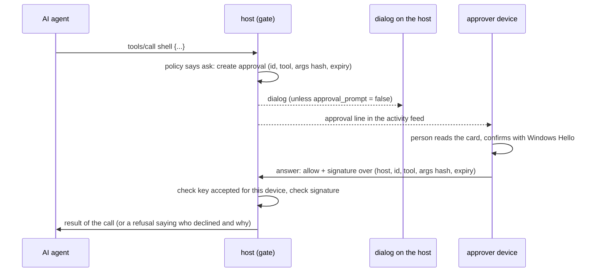

# Remote approvals

[中文](approvals.zh-CN.md)

Some calls wait for a person: `shell`, `jobs_start`, admin tools of mounted servers, and anything a
policy rule marks `ask`. M0 asked only in a dialog on the host's own desktop, so an approval needed
someone sitting at the controlled machine. Remote approvals let the owner answer from a paired device
too (the controller CLI today, the desktop and iPhone apps next), while making sure that an AI agent
can never approve its own request, not even one running on that same device.

## How it works



1. When a call needs approval, the host creates a request with a random 128-bit id and an expiry
   (`approval_timeout_secs`, default 60). It writes an `approval` line to the audit log, which is also
   the activity feed, and shows its own dialog unless `approval_prompt = false`.
2. **The first answer wins**: the dialog on the host, or an answer from a paired device. Other answers
   are refused with "nothing is waiting".
3. **Allowing needs a signature.** The answering device signs exactly this call: the host's device id
   (from its own pairing record, never from the host's message), the approval id, the tool, the BLAKE3
   hash of the arguments and the expiry. A signature for one call is worthless for any other.
4. **Denying needs none.** Any paired device with a level can deny, with an optional note that the
   agent receives ("Tell the agent instead").
5. No answer before the expiry means denied. So does having nobody who could answer: no usable
   desktop on the host (or `approval_prompt = false`) and no approver key.
6. The host records the outcome (`approval_resolved`: verdict, who, note, time waited) and links the
   call's `decision` record to the approval with `approval` and `by`.

## Approver keys

An approver key is a key pair the controller device's operating system creates and keeps behind a
presence check, so producing a signature needs the person, not just the user account or the device's
files:

| Device | Key | What the person does to allow |
|---|---|---|
| Windows | Windows Hello key credential (RSA 2048, RSASSA-PKCS1-v1_5 with SHA-256) | PIN, fingerprint or face, for every allow |
| macOS | Secure Enclave P-256 key with user presence (planned with the macOS controller) | Touch ID or the login password |
| iPhone | Secure Enclave P-256 key with Face ID (planned with the iOS app) | Face ID |

The private key never leaves the OS. The host stores only public keys, in
`<profile>/host/approvers.json`, each tied to one paired device: a key is only accepted from the device
it was registered for, and forgetting the device removes its keys.

A host accepts a new key only when someone at the host confirms it, in one of two ways:

- **From the device:** `ai-remote approver --enroll <host>` creates the key if needed (Windows asks the
  person to confirm with Windows Hello) and offers it to the host, which shows a prompt naming the
  device, the key and its fingerprint. This needs a usable desktop on the host and
  `approval_prompt = true`.
- **At the host:** copy the key that `ai-remote approver --create` prints on the device and run
  `ai-remote approvers add <device> <scheme>:<key>` in the host's terminal.

## Commands

| Where | Command | What it does |
|---|---|---|
| controller | `ai-remote approver [--create]` | show this device's approver key and fingerprint; `--create` makes it if there is none (only then does Windows Hello ask) |
| controller | `ai-remote approver --enroll <host>` | offer the key to a host; someone there confirms it |
| controller | `ai-remote approvals [--host H]` | list what is waiting for approval |
| controller | `ai-remote approve <id> [--host H]` | allow one waiting call (Windows Hello asks first) |
| controller | `ai-remote deny <id> [--host H] [--note TEXT]` | deny one waiting call, optionally telling the agent why |
| host | `ai-remote approvers` | accepted approver keys, by device |
| host | `ai-remote approvers add <device> <scheme>:<key> [--label L]` | accept a key without a prompt |
| host | `ai-remote approvers remove <device> [--fingerprint F]` | remove a device's keys |

`<id>` may be shortened to its first 6 or more characters when that is unambiguous.

```toml
# ai-remote.toml (host)
[host]
approval_timeout_secs = 300   # give people on other devices time to answer
approval_prompt = false       # optional: nobody sits at this machine, approve only from devices
```

## Threat model

The point of an approval is that a person, not the agent, decides. The agent may run on the host it
operates, on the controller device the person approves from, or both.

| Threat | What stops it | What remains |
|---|---|---|
| The agent approves through its MCP tools | No MCP tool answers approvals; the approval channel is not part of the MCP surface | none |
| The agent drives the desktop app or runs `ai-remote approve` on the controller device (same user account) | Allowing needs a Windows Hello signature; the agent can start the request but only the person can complete the check | The person could confirm a Windows Hello prompt they did not start. The app shows what is being approved right before the prompt; read it |
| The agent copies the device's files (identity key, profile) and talks to the host itself | It can deny, nothing more: allowing needs the approver key, which is not in any file | none |
| The agent offers its own (software) key as an approver key | The host accepts a key only after someone at the host confirms it in a prompt or adds it in the host's terminal | A person who accepts a key they did not set up themselves. The prompt says to accept only while setting it up yourself |
| The agent clicks the host's own dialog | Input tools refuse while a dialog is open and never aim at the host's own windows ([operations.md](operations.md#9-approvals)) | none known |
| The agent replays a signature for another call | The signature covers host, approval id, tool, argument hash and expiry; ids are random and used once | none |
| Someone on the network | Every connection is mutually authenticated and encrypted (iroh QUIC); only paired devices with a level reach the channel | none |
| A stolen controller device | Revoke or forget it on the host; forgetting removes its approver keys. Windows Hello still guards each allow | none beyond normal device theft |
| The agent already has `shell` on the host | A shell runs as the host's user and can change the host's own configuration. Approve `shell` and `jobs_start` only after reading the command | inherent to shell access |

## Wire format

Approvals use the host's events channel (`app/ai-remote/events/1`). The controller opens one stream per
request and writes one JSON line; the host answers with one line, `{"ok":true,...}` or
`{"ok":false,"error":"..."}`.

| Request | Reply |
|---|---|
| `{"pending":true}` | `{"device":"eid:…","pending":[{id, session, peer, tool, intent, args_hash, args_preview, expires_ms, host_prompt}]}` |
| `{"answer":{"id":"…","decision":"deny","note":"…"}}` | `{}` |
| `{"answer":{"id":"…","decision":"allow","alg":"rsa-pkcs1-sha256","key":"<base64 SPKI>","signature":"<base64>"}}` | `{}` |
| `{"enroll":{"alg":"…","key":"<base64 SPKI>","label":"Windows Hello on laptop"}}` | `{"added":true,"fingerprint":"…"}` after the host's prompt |
| `{"approver_status":{"alg":"…","key":"…"}}` | `{"accepted":true}` |

The signed message is UTF-8 text:

```
ai-remote approval v1
allow
host eid:<host device id>
id <approval id>
tool <tool name>
args <BLAKE3 hex of the canonical argument JSON>
expires <milliseconds since the Unix epoch>
```

The feed (`{"subscribe":true}`) carries the same requests as audit lines: `approval` when a call starts
waiting, `approval_resolved` when it ends (`approved`, `denied`, `timeout`, `unavailable`,
`cancelled`), and `approver_added` / `approver_removed`. Its first line (`hello`) also lists what is
waiting at that moment, so an app that subscribes late still shows every open request.

## Not yet

- Approving from macOS and iPhone (needs their Secure Enclave code; they can deny meanwhile).
- The desktop app's approval card (it uses the calls above) and phone notifications.
- Wider scopes than "once" (for example "for the next 10 minutes"); today every allow covers one call.
- Closing the host's dialog when a device answered first: it stays on screen with its answer ignored
  until the replacement host window lands.
