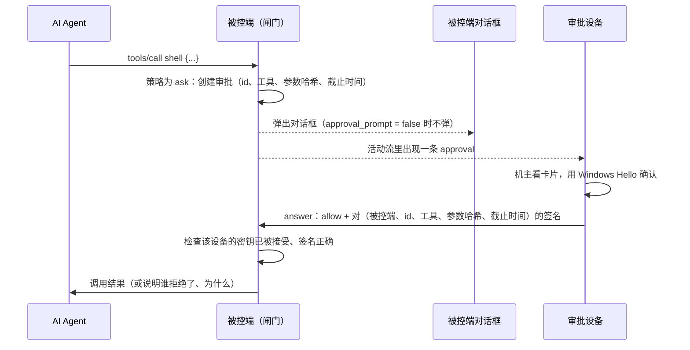

# 远程审批

[English](approvals.md)

有些调用要等人点头：`shell`、`jobs_start`、挂载 server 的 admin 级工具，以及策略规则标成 `ask` 的任何工具。
M0 只会在被控端自己的桌面上弹对话框，所以审批时必须有人坐在被控机器前。远程审批让机主也能在已配对的设备上回答
（目前是控制端命令行，接下来是桌面应用和 iPhone 应用），同时保证 AI Agent 永远批准不了自己的请求，哪怕它就跑在
机主审批用的那台设备上。

## 工作方式



1. 调用需要审批时，被控端生成一个请求：128 位随机 id 和截止时间（`approval_timeout_secs`，默认 60 秒）。
   它往审计日志写一条 `approval`（审计日志同时就是活动流），并弹出自己的对话框，除非设置了 `approval_prompt = false`。
2. **先到的回答生效**：被控端的对话框，或者某台已配对设备的回答。之后的回答都会被拒绝，提示“没有在等的审批”。
3. **允许必须带签名。** 回答的设备签的正是这一次调用：被控端的设备 ID（取自它自己的配对记录，从不采信被控端发来的
   内容）、审批 id、工具名、参数的 BLAKE3 哈希和截止时间。给一次调用的签名，对任何其他调用都无效。
4. **拒绝不需要签名。** 任何有权限级别的已配对设备都能拒绝，还可以附一句话转告 Agent（“改为告诉 Agent”）。
5. 截止前没人回答就按拒绝处理。没有人能回答时也一样：被控端没有可用的桌面（或 `approval_prompt = false`），
   又没有审批密钥。
6. 被控端记录结果（`approval_resolved`：结论、谁回答的、附言、等了多久），并在这次调用的 `decision` 记录里用
   `approval` 和 `by` 关联到这次审批。

## 审批密钥

审批密钥是控制端设备的操作系统生成并保管的一对密钥，用它签名需要通过“本人在场”检查，所以光有用户账户或设备上的
文件是签不出来的：

| 设备 | 密钥 | 机主允许时要做什么 |
|---|---|---|
| Windows | Windows Hello 密钥凭据（RSA 2048，RSASSA-PKCS1-v1_5 + SHA-256） | 每次允许都输入 PIN 或验证指纹、人脸 |
| macOS | 带用户在场要求的 Secure Enclave P-256 密钥（随 macOS 控制端提供） | Touch ID 或登录密码 |
| iPhone | 带 Face ID 要求的 Secure Enclave P-256 密钥（随 iOS 应用提供） | Face ID |

私钥从不离开操作系统。被控端只保存公钥，位于 `<profile>/host/approvers.json`，每把公钥都绑定一台已配对设备：
只有登记时的那台设备能用它，忘记（forget）这台设备时它的密钥一并删除。

被控端接受新密钥前，必须有人在被控端确认，方式有两种：

- **在设备上发起：** `ai-remote approver --enroll <被控端>` 会按需生成密钥（Windows 会请机主用 Windows Hello 确认），
  然后提交给被控端；被控端弹出提示，写明设备名、密钥和它的指纹。这要求被控端桌面可用，且 `approval_prompt = true`。
- **在被控端添加：** 复制设备上 `ai-remote approver --create` 打印的密钥，在被控端的终端里运行
  `ai-remote approvers add <设备> <算法>:<密钥>`。

## 命令

| 在哪里运行 | 命令 | 作用 |
|---|---|---|
| 控制端 | `ai-remote approver [--create]` | 显示本设备的审批密钥和指纹；没有密钥时用 `--create` 生成（只有这时才会弹出 Windows Hello） |
| 控制端 | `ai-remote approver --enroll <被控端>` | 把密钥提交给被控端，由那边的人确认 |
| 控制端 | `ai-remote approvals [--host H]` | 列出正在等审批的调用 |
| 控制端 | `ai-remote approve <id> [--host H]` | 允许一个等待中的调用（先要通过 Windows Hello） |
| 控制端 | `ai-remote deny <id> [--host H] [--note 文字]` | 拒绝一个等待中的调用，可以顺便告诉 Agent 原因 |
| 被控端 | `ai-remote approvers` | 已接受的审批密钥，按设备列出 |
| 被控端 | `ai-remote approvers add <设备> <算法>:<密钥> [--label L]` | 不弹提示，直接接受一把密钥 |
| 被控端 | `ai-remote approvers remove <设备> [--fingerprint F]` | 删除某台设备的密钥 |

`<id>` 在不产生歧义时可以只写前 6 位或更多。

```toml
# ai-remote.toml（被控端）
[host]
approval_timeout_secs = 300   # 给其他设备上的人留出回答时间
approval_prompt = false       # 可选：这台机器没人坐着，只在设备上审批
```

## 威胁模型

审批的意义在于：由人而不是 Agent 来做决定。Agent 可能跑在它操作的被控端上，也可能跑在机主用来审批的控制端设备上，
或者两边都有。

| 威胁 | 怎么挡住 | 剩下的风险 |
|---|---|---|
| Agent 通过它的 MCP 工具批准 | 没有任何 MCP 工具能回答审批；审批通道不在 MCP 接口里 | 无 |
| Agent 在控制端设备上操作桌面应用，或运行 `ai-remote approve`（同一个用户账户） | 允许必须有 Windows Hello 签名；Agent 能发起请求，但只有本人能完成验证 | 机主可能确认了一个不是自己发起的 Windows Hello 提示。应用会在提示出现前显示要批准的内容，请先看清楚 |
| Agent 复制设备上的文件（身份密钥、配置目录），自己去连被控端 | 它最多只能拒绝：允许需要审批密钥，而审批密钥不在任何文件里 | 无 |
| Agent 把自己的（软件）密钥登记成审批密钥 | 被控端只在有人当场确认提示、或在被控端终端里手动添加后才接受密钥 | 机主接受了一把不是自己正在设置的密钥。提示里写明了只在自己正在设置时才接受 |
| Agent 点击被控端自己的对话框 | 对话框打开期间输入类工具一律拒绝，且永远不会对准被控端自己的窗口（见 [operations.zh-CN.md](operations.zh-CN.md#9-审批)） | 目前未知 |
| Agent 拿一次调用的签名去重放另一次 | 签名覆盖被控端、审批 id、工具、参数哈希和截止时间；id 随机且只用一次 | 无 |
| 网络上的第三方 | 每条连接都双向认证并加密（iroh QUIC）；只有有权限级别的已配对设备能进入审批通道 | 无 |
| 控制端设备被偷 | 在被控端撤销或忘记它；忘记会删除它的审批密钥。每次允许仍有 Windows Hello 把关 | 与一般设备失窃相同 |
| Agent 已经能在被控端用 `shell` | shell 以被控端用户的身份运行，能改被控端自己的配置。批准 `shell` 和 `jobs_start` 前请读清命令 | shell 权限本身的风险 |

## 通信格式

审批走被控端的事件通道（`app/ai-remote/events/1`）。控制端每个请求开一条流、写一行 JSON；被控端回一行
`{"ok":true,...}` 或 `{"ok":false,"error":"..."}`。

| 请求 | 回复 |
|---|---|
| `{"pending":true}` | `{"device":"eid:…","pending":[{id, session, peer, tool, intent, args_hash, args_preview, expires_ms, host_prompt}]}` |
| `{"answer":{"id":"…","decision":"deny","note":"…"}}` | `{}` |
| `{"answer":{"id":"…","decision":"allow","alg":"rsa-pkcs1-sha256","key":"<base64 SPKI>","signature":"<base64>"}}` | `{}` |
| `{"enroll":{"alg":"…","key":"<base64 SPKI>","label":"Windows Hello on laptop"}}` | 被控端确认后返回 `{"added":true,"fingerprint":"…"}` |
| `{"approver_status":{"alg":"…","key":"…"}}` | `{"accepted":true}` |

签名的消息是 UTF-8 文本：

```
ai-remote approval v1
allow
host eid:<被控端设备 ID>
id <审批 id>
tool <工具名>
args <规范化参数 JSON 的 BLAKE3 十六进制>
expires <Unix 纪元以来的毫秒数>
```

活动流（`{"subscribe":true}`）以审计记录的形式带着同样的信息：调用开始等待时一条 `approval`，结束时一条
`approval_resolved`（`approved`、`denied`、`timeout`、`unavailable`、`cancelled`），以及
`approver_added` / `approver_removed`。第一行（`hello`）还会列出此刻正在等待的审批，所以晚订阅的应用也能显示所有未决请求。

## 还没做的

- 在 macOS 和 iPhone 上允许（需要它们的 Secure Enclave 代码；在此之前它们可以拒绝）。
- 桌面应用的审批卡片（它用的就是上面这些调用）和手机通知。
- 比“仅此一次”更宽的范围（例如“接下来 10 分钟”）；目前每次允许只覆盖一次调用。
- 设备先回答后关闭被控端的对话框：在新的被控端窗口上线之前，它会留在屏幕上，回答被忽略。
