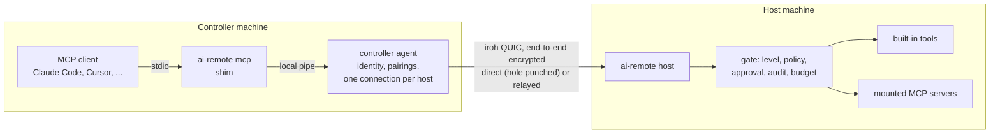

# ai-remote architecture

[中文](architecture.zh-CN.md) | English

> Status: pre-alpha. Milestone M0 (CLI, Windows host, MCP bridge) is in progress. Sections marked
> *(planned)* are not implemented yet.

## 1. What ai-remote is

ai-remote is an open-source remote control system where **AI agents are first-class operators**.
A person can still watch and take over at any time, but the main interface of a controlled machine
is a set of structured, permissioned and audited tools rather than a video stream.

| Role | Platforms | What it does |
|---|---|---|
| **Host** (the controlled machine) | Windows, macOS *(planned)* | Runs `ai-remote host`. Offers its capabilities (screen, input, UI, shell, jobs, mounted MCP servers) as MCP tools over an encrypted peer-to-peer connection. Enforces per-device levels, asks its owner before risky actions, writes an audit log. |
| **Controller** | Windows, macOS, iOS *(planned)* | Pairs with hosts and operates them. `ai-remote mcp` lets any MCP client (Claude Code, Cursor, custom agents) drive every paired host. Human apps come later. |

iOS can only be a controller: iOS does not let a third-party app control the device it runs on.

## 2. Principles

1. **AI is a first-class client.** The host speaks the Model Context Protocol natively. Structured UI
   (accessibility tree with element references) is the preferred way to act; mouse and keyboard are
   the fallback. Screenshots are scaled for models and carry the geometry needed to map a point back.
2. **People stay in charge.** Every paired device has a level, risky tools ask the owner, every call
   is audited, and the owner can revoke a device instantly. When nobody can answer a prompt, the
   answer is no.
3. **Dial keys, not IP addresses.** Devices are Ed25519 identities. Connections are end-to-end
   encrypted QUIC with NAT hole punching and an encrypted relay fallback. No port forwarding, no VPN.
4. **No server required.** Pairing uses a one-time ticket. An optional, self-hostable account service
   *(planned)* would only distribute device keys and grants, never session traffic.
5. **Reuse before writing.** ai-remote builds on maintained open-source components (section 9) and
   writes only what is specific to it: the gate, the tools, the bridge and the apps.

## 3. System overview



## 4. Identity, pairing and levels

- **Identity.** Each role (host, controller) has its own Ed25519 key in the user's profile directory
  (`identity.key`). We hold the key ourselves and hand it to the transport, so the device id would
  survive a change of transport library.
- **Pairing.**
  1. On the host: `ai-remote pair-code --level control` mints a single-use invite (expires within a
     day). A fresh host prints one automatically.
  2. On the controller: `ai-remote pair <ticket> --name office-pc`.
  3. Both sides show the same three-word safety code; the person checks they match, which defeats a
     swapped ticket.
- **Levels** (ordered):

  | Level | Allows |
  |---|---|
  | `observe` | system info, screenshots, window list, UI tree |
  | `control` | + mouse, keyboard, focus, clipboard, UI actions |
  | `admin` | + shell, background jobs, files |

  `ai-remote level <peer> admin` changes a level; it applies to the next call, even inside a live
  session. `ai-remote revoke <peer>` refuses the device and cuts its live connections immediately.

## 5. Transport and wire protocol

- **Transport.** [iroh](https://github.com/n0-computer/iroh) QUIC through an embedded
  [mcpmesh](https://github.com/counterpunchtech/mcpmesh) node, which provides pairing, the
  default-deny gate on every connection and revocation. All of it sits behind one crate, `ar-net`,
  so nothing else depends on mcpmesh.
- **ALPN `app/ai-remote/mcp/1`.** One bidirectional stream per MCP session, newline-delimited
  JSON-RPC exactly like MCP's stdio framing. The controller is the MCP client, the host the server.
  The controller keeps one connection per host and opens a stream per session.
- **Relays.** The public n0 relays by default (they only see ciphertext); self-hosted
  [iroh-relay](https://github.com/n0-computer/iroh) servers via `[network] relays = [...]`.
- *(planned)* `app/ai-remote/screen/1` for live video to people, `app/ai-remote/file/1` for bulk
  file transfer.

## 6. The gate

Every tool call, built-in or mounted, goes through the same pipeline on the host:

1. **Level**: the caller's current level must reach the tool's level.
2. **Policy**: rules in `ai-remote.toml`, first match wins; otherwise the tool's default
   (observe and control tools run, admin tools ask). Annotations from mounted servers are hints, never
   the authority.
3. **Approval**: for `ask`, a native dialog on the host's desktop shows who asks, the tool, the stated
   intent and the arguments. No answer before the timeout, a locked desktop, or an unattended machine
   all mean **denied**.
4. **Audit**: a JSONL record before the call (decision) and after it (outcome, duration, size, error),
   with a BLAKE3 hash of the arguments.
5. **Call**: bounded by the session; when the controller disconnects or is revoked, the call is
   cancelled and child processes are killed.
6. **Budget**: large text is cut to its head and tail with a count of what was dropped, so one
   result cannot flood an agent's context.

```toml
# ai-remote.toml (host)
[host]
name = "office-pc"
approval_timeout_secs = 60

[[rule]]
tool = "shell"
action = "ask"

[[rule]]
tool = "*"
principal = "build-bot"
action = "deny"
```

## 7. Host tools (M0)

| Tool | Level | What it does |
|---|---|---|
| `system_info` | observe | OS, monitors, session state (interactive, console, locked, elevated), your level |
| `doctor` | observe | graded checks with reasons and fixes *(in progress)* |
| `screenshot` | observe | capture a monitor, downscale (default 1280 px), return image and geometry *(in progress)* |
| `zoom` | observe | native-resolution crop of a region of a screenshot *(in progress)* |
| `list_windows` | observe | top-level windows with app, pid, bounds, focus *(in progress)* |
| `focus_window` | control | bring a window to the front *(in progress)* |
| `mouse` | control | move, click, drag, scroll in screenshot coordinates *(in progress)* |
| `keyboard` | control | type text, press keys and chords *(in progress)* |
| `clipboard_read` / `clipboard_write` | control | text clipboard *(in progress)* |
| `shell` | admin, asks | run a command with timeout and process-tree kill |
| `jobs_*` | admin | background jobs with logs, wait, kill *(in progress)* |
| `<mount>_<tool>` | per allowlist | tools of mounted MCP servers *(in progress)* |

Coordinates: `screenshot` returns an id; `mouse` takes points in that screenshot's pixels and the host
maps them to the screen, so a model never deals with DPI scaling or multi-monitor offsets.

### Mounted MCP servers

The host can start local MCP servers as child processes and expose an **allowlist** of their tools
through the gate, named `<mount>_<tool>`. This is how ai-remote reuses existing work instead of
rewriting it; the default accessibility provider is
[cua-driver](https://github.com/trycua/cua) (MIT), which gives element-level UI actions on Windows
and macOS. Tools a server adds in a later version stay hidden until allowlisted. The binary's
SHA-256 is checked before every start.

```toml
[[mount]]
name = "ui"
command = "C:/Users/me/AppData/Local/ai-remote/data/host/mounts/cua-driver/cua-driver.exe"
args = ["mcp"]
sha256 = "..."
[mount.tools]
get_window_state = "observe"
click = "control"
launch_app = { level = "control", approve = "ask" }
```

## 8. Processes and platform rules

- **The host runs in the logged-in user's interactive session, never as a service.** On Windows a
  service lives in session 0, which has no desktop: screenshots are black, input goes nowhere and no
  approval prompt can appear. `ai-remote host install` *(in progress)* registers a task that starts
  the host at logon with highest privileges and an interactive token, and pre-creates a firewall rule
  so the first listen does not raise a prompt nobody answers. On macOS the equivalent is a per-user
  LaunchAgent *(planned)*.
- **Session state is reported, not guessed.** `system_info` and `doctor` say whether the process is in
  an interactive session, on the console, elevated, and whether the desktop is locked, so an agent can
  tell "I cannot see" from "there is nothing there".
- **DPI.** The Windows host is per-monitor DPI aware, so capture, UI bounds and input share one
  physical-pixel coordinate space.
- **Controller process model.** `ai-remote agent` is a per-user daemon that owns the controller
  identity and one connection per host. `ai-remote mcp` is a thin stdio shim that the MCP client
  starts; it starts the agent on demand and relays to it. Many shims share one agent. The local pipe
  is owner-only and never relies on half-close (a Windows named pipe does not deliver it).
- **Profiles.** Everything lives in a per-user profile directory (`--home` or `AI_REMOTE_HOME`
  overrides it), so several identities can run side by side for testing.

## 9. What we reuse

| Need | Component | License |
|---|---|---|
| P2P QUIC, hole punching, relays | iroh (n0) | MIT / Apache-2.0 |
| Pairing, gate, revocation, local pipes | mcpmesh-node (pinned; see below) | MIT / Apache-2.0 |
| MCP protocol | rmcp (official Rust SDK) | Apache-2.0 |
| Screen capture | xcap | Apache-2.0 |
| Input injection | enigo | MIT |
| Image scaling and encoding | image | MIT / Apache-2.0 |
| Process trees | process-wrap | MIT / Apache-2.0 |
| Native dialogs | rfd | MIT |
| System facts | sysinfo | MIT |
| Accessibility tree (mounted) | cua-driver | MIT |

mcpmesh 0.58.0 pins iroh 1.2, rmcp 3.1 and a since-yanked iroh-blobs 0.103.0. ai-remote uses a fork
that changes only those three versions (iroh 1.3.0, rmcp 3.5.1, iroh-blobs 0.103.1); its own test
suites pass unchanged. If mcpmesh stops being maintained, `ar-net` can be re-implemented directly on
iroh without touching the rest of ai-remote.

## 10. Code layout

```
crates/
  ar-core/        profile layout, device key, levels, host config, result budgets
  ar-net/         transport seam (mcpmesh + iroh), local IPC
  ar-host/        host: gate, approval, audit, MCP server, tools, mounts, platform facts
  ar-controller/  agent, aggregated MCP server, stdio shim
  ai-remote/      the `ai-remote` command
docs/
assets/brand/     logo, banners, demo
```

## 11. Milestones

| Milestone | Scope |
|---|---|
| **M0** (now) | CLI; Windows host with screen, input, clipboard, shell, jobs, mounts and the gate; MCP bridge for agents; logon-task install; doctor |
| M1 | macOS host (ScreenCaptureKit, accessibility, LaunchAgent), file transfer, interactive terminal, keys in the OS keystore, CI on real desktops |
| M2 | live video for people (`screen/1`), desktop app with approvals and an "AI is operating" indicator |
| M3 | iOS controller app (SwiftUI over the Rust core via UniFFI), App Store release |
| M4 | optional self-hostable account service and relay, device sharing |
