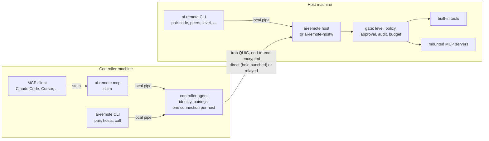

# ai-remote architecture

[中文](architecture.zh-CN.md) | English

> Status: pre-alpha. The M0 scope (CLI, Windows host, MCP bridge) is implemented on the main branch,
> but nothing is released and commands may still change. Sections marked *(planned)* are not
> implemented yet.
>
> This page is the overview. For running hosts and controllers see [operations.md](operations.md);
> for every tool, its parameters and the configuration formats see [tools.md](tools.md).

## 1. What ai-remote is

ai-remote is an open-source remote control system where **AI agents are first-class operators**.
A person can still watch and take over at any time, but the main interface of a controlled machine
is a set of structured, permissioned and audited tools rather than a video stream.

| Role | Platforms | What it does |
|---|---|---|
| **Host** (the controlled machine) | Windows, macOS *(planned)* | Runs `ai-remote host` in a terminal, or `ai-remote-hostw` in the background from logon. Offers its capabilities (screen, input, windows, clipboard, shell, background jobs, mounted MCP servers) as MCP tools over an encrypted peer-to-peer connection. Enforces per-device levels, asks its owner before risky actions, writes an audit log. |
| **Controller** | Windows, macOS, iOS *(planned)* | Pairs with hosts and operates them. `ai-remote mcp` lets any MCP client (Claude Code, Cursor, custom agents) drive every paired host. Human apps come later. |

iOS can only be a controller: iOS does not let a third-party app control the device it runs on.

## 2. Principles

1. **AI is a first-class client.** The host speaks the Model Context Protocol natively. Structured UI
   (an accessibility tree with element references, from a mounted server such as cua-driver) is the
   preferred way to act; mouse and keyboard are the fallback. Screenshots are scaled for models and
   carry the geometry needed to map a point back to the screen.
2. **People stay in charge.** Every paired device has a level, risky tools ask the owner, every call
   is audited, and the owner can revoke a device instantly. When nobody can answer a prompt, the
   answer is no.
3. **Dial keys, not IP addresses.** Devices are Ed25519 identities. Connections are end-to-end
   encrypted QUIC with NAT hole punching and an encrypted relay fallback. No port forwarding, no VPN.
4. **No server required.** Pairing uses a one-time ticket, handed over behind an eight-digit pair code. An optional, self-hostable account service
   *(planned)* would only distribute device keys and grants, never session traffic.
5. **Reuse before writing.** ai-remote builds on maintained open-source components (section 9) and
   writes only what is specific to it: the gate, the tools, the bridge and the apps.

## 3. System overview



The local pipes are owner-only named pipes (Windows) or 0600 Unix sockets, one per role and profile.

## 4. Identity, pairing and levels

- **Identity.** Each role (host, controller) has its own Ed25519 key in the user's profile directory
  (`identity.key`). We hold the key ourselves and hand it to the transport, so the device id would
  survive a change of transport library.
- **Pairing.** A person pairs with a short **pair code**: the host shows a QR code and eight digits
  (`4821 0937`) for ten minutes; a phone scans the QR code, a computer types the digits. The long
  **ticket** (`mcpmesh-invite:...`, about 1000 characters) is still there underneath and still works
  on its own, for machines that cannot reach each other over the network.
  1. On the host: the desktop app's This device → Show pair code (or the tray's Show Pairing Code),
     or `ai-remote pair-code --level control` in a terminal (it prints the QR code in block
     characters, the digits and the ticket). Each request mints a single-use ticket (24 hours) and a
     fresh code that hands it out; showing a new code withdraws the old one. A host started in a
     terminal with nobody paired shows one itself; the background host never does, because a code
     and a ticket are credentials and a log is no place for them.
  2. On the controller: the desktop app's Pair a computer page, the iPhone app's scanner or code
     field, or `ai-remote pair 4821 0937 --name office-pc` (`ai-remote pair <ticket>` still works).
     It shows a three-word safety code and the level the host grants.
  3. The host shows the same three words (its pairing dialog, its terminal, and always its log).
     Different words mean someone else used the code; the host owner removes that device.

  The ticket carries the host's public key, so the controller can only reach that host; the
  transport authenticates both ends, so the host learns the controller's real key.

### How a short code reaches the host (design note, 2026-10)

The problem: the ticket is the right credential (a 32-byte secret, the host's key and its
addresses, so it needs no server), but nobody wants to read 1000 characters from one screen into
another. What a short code has to do is *find* the host and *hand over* the ticket, without
becoming the weak point.

What others do, and what we took:

| | How the short thing finds the other side | What stops guessing |
|---|---|---|
| Magic Wormhole | code = nameplate number + words; a mailbox server pairs the two sides by nameplate | SPAKE2 over the mailbox: one online guess per attempt, the code is burned after one failure |
| AirDrop / screen-mirroring codes | the devices find each other on the local network (Bluetooth / mDNS); the code only authenticates | 4-digit code, a few tries, seconds of validity, and physical proximity |
| RustDesk | a 9-digit ID registered at its rendezvous server + a one-time password | server-side rate limits on the password |
| Tailscale / iroh tickets | no short code: the ticket *is* the address and the key, copied whole or as a QR code | the 256-bit secret |

ai-remote has no rendezvous server of its own and should not need one, but every node already
publishes its address through n0's DNS/pkarr service and (with `lan_discovery`) mDNS, keyed by its
endpoint id. So the code is turned into an endpoint id:

1. **Stretch.** Both sides run Argon2id over the eight digits (64 MiB, 3 passes, fixed salt)
   into 64 bytes: the secret key of a short-lived **rendezvous endpoint**, and an authentication key.
2. **Host.** While the code is shown, the host runs that rendezvous endpoint next to its node, with
   the node's own relays, proxy and local discovery, serving only ALPN `app/ai-remote/pair-code/1`.
   It publishes its address like any endpoint. It is a separate endpoint on purpose: the node's
   default-deny gate admits paired devices only (an unpaired controller could never reach a new
   ALPN on it), and the node's identity is never published under a key derived from 27 bits.
3. **Controller.** Derives the same endpoint id from the code and dials it from a throwaway
   endpoint (address lookup through DNS/pkarr, mDNS and the relays finds it on the same LAN or
   across the internet). TLS proves the far side holds the code-derived key. The controller proves
   it knows the code with a keyed BLAKE3 hash of both endpoint ids; then the host sends its ticket,
   and the controller redeems it exactly as a pasted ticket (same mcpmesh ceremony, same safety
   words).
4. **Limits.** A code lasts 10 minutes (or less, if the ticket expires first), delivers one ticket,
   and is burned after 5 connections that fail to prove it. The rendezvous endpoint shuts down as
   soon as the code is used, burned or expired, so its id stops being published.

Why not SPAKE2 with a public "channel" part, like Wormhole: the channel would have to name a
rendezvous point everyone can compute, which on a shared DNS service means anyone can publish
records for every channel (squatting, denial of service) and two hosts showing the same channel at
once collide. Deriving the whole rendezvous id from the whole code avoids both, at the cost below.

What resists what (derived from the parameters, not measured as attacks):

- **Online guessing** (no knowledge of any code): each guess is one Argon2id run plus one DNS
  lookup, and hits only while some host shows exactly that code; 10^8 codes, 10 minutes each.
  Someone who reaches the rendezvous endpoint without the code has 5 tries.
- **Offline search by an observer of the rendezvous id** (n0's DNS service, a relay, or a device on
  the same LAN listening to mDNS): the id lets them test candidate codes offline, one Argon2id run
  each. One run takes 78 ms on an Apple M5 Max core (release build; `kdf_cost` test, 20 runs), so
  searching the whole code space within the 10 minutes needs about 13,000 such cores with 64 MiB
  each (half that on average). That is out of reach of a casual attacker, not of a large
  one; the safety words are the backstop (an attacker who wins pairs as a visible new device with
  different words, and the owner removes it).
- **Typos** are not detected locally (all eight digits are random); a wrong code ends with "no
  device answered this pair code" after the 20-second search.
- **No network between the two machines** (no internet and no shared LAN): only the ticket works.
- **A name clash** (the host still lists an earlier install of this device, or another machine with
  the same name) is refused by mcpmesh before the ticket is spent; the controller then claims
  `<name>-<first 4 hex digits of its device id>` and redeems the same ticket once more, because a
  pair code cannot be used twice.

Measured between two machines (2026-10-21, Mac controller and Windows host on different subnets,
debug builds): 5 of 7 attempts paired in 2.9–5.8 s; one was a deliberately withdrawn code ("no
device answered" after 10 s); two attempts shortly after the host started failed the same way and
are not explained yet (see `AGENTS.md`).

The QR code holds `ai-remote://pair?code=48210937`, not the ticket: it is a small version-3 code
(29 modules) that phones read from across a desk, and the system camera opens the iPhone app on
it. A QR code holding the ticket itself would need more than 100 modules a side (estimated from the
ticket's length, not tried).

- **Levels** (ordered):

  | Level | Allows |
  |---|---|
  | `observe` | system info, doctor, screenshots, zoom, window list |
  | `control` | + mouse, keyboard, focus, clipboard, UI actions of mounted servers |
  | `admin` | + shell and background jobs (files are *(planned)*) |

- **Owner controls** (run on the host; each takes effect at once, even inside a live session):

  | Command | Effect |
  |---|---|
  | `ai-remote level <peer> <level\|none>` | changes the level; the next call is checked against it |
  | `ai-remote revoke <peer>` | refuses the device from now on, even with a new ticket, and cuts its live connections; the pairing is kept |
  | `ai-remote unrevoke <peer>` | lifts a revocation (by device id once the pairing is gone) |
  | `ai-remote forget <peer>` | removes the pairing and cuts live connections; the device can come back only with a new ticket |

  The details, including what the controller hears in each case, are in
  [operations.md](operations.md#6-levels-revoke-unrevoke-forget).

## 5. Transport and wire protocol

- **Transport.** [iroh](https://github.com/n0-computer/iroh) QUIC through an embedded
  [mcpmesh](https://github.com/counterpunchtech/mcpmesh) node, which provides pairing, the
  default-deny gate on every connection and revocation. All of it sits behind one crate, `ar-net`,
  so nothing else depends on mcpmesh.
- **ALPN `app/ai-remote/mcp/1`.** One bidirectional stream per MCP session, newline-delimited
  JSON-RPC exactly like MCP's stdio framing. The controller is the MCP client, the host the server.
  The controller keeps one connection per host and opens a stream per session.
- **Refusals.** A host that will not serve a device closes the connection with a code and a reason:
  the transport's 401 for unknown or revoked devices, the host's 403 for "not paired" or "no access
  level", code 0 when the host stops. The controller turns them into plain language with the fix
  ("access revoked by the host", "not paired", "no access level", "host offline or unreachable" with
  the raw cause), does not redial into a refusal that only a person can lift, and remembers a
  revocation while the controller agent runs, because later dials only meet the gate's generic 401
  (after the agent restarts, a revoked controller hears "not paired"). When the host owner has to
  act, the message includes the controller's device id. The full list is in
  [operations.md](operations.md#7-when-a-host-refuses).
- **Calls in flight.** A call whose connection ends while it runs is never re-sent: its request may
  already have run on the host, so the agent is told the outcome is unknown. Starting a session has
  no side effects, so a session start on a kept connection that fails or gets no answer within 8
  seconds is retried once on a fresh connection (unless the host refused this device).
- **Relays and reaching a peer.** The public n0 relays by default (they only see ciphertext); host and
  controller can use self-hosted [iroh-relay](https://github.com/n0-computer/iroh) servers via
  `[network] relays = [...]`, with n0's relays kept as a fallback. Local-network (mDNS) discovery, an
  HTTP proxy for the relay connection (detected from the environment or the system) and dial retries
  are on by default; see [operations.md](operations.md#12-connecting-across-networks). The controller
  reports each connection's route (`path`, `relay`, `relay_n0`) and every client says when P2P failed.
- **ALPN `app/ai-remote/events/1`.** The activity feed and the approval channel. A controller opens
  a stream per request and writes one JSON line: `{"subscribe":true}` returns the host's recent audit
  lines and then every new one (tool decisions and outcomes, sessions, approvals), which `ai-remote
  watch` and the apps turn into the agent's timeline; `pending`, `answer`, `enroll` and
  `approver_status` serve remote approvals ([approvals.md](approvals.md#wire-format)); `turn` (take
  over, hand back, pause, resume) and `tell` (a message for the agent) serve turn-taking; `access`
  (this device's level, the rules that concern it, the paired devices for an admin, the tools on
  offer), `lower` (lower its own level, never raise it) and `leave` (unpair itself) serve the app's
  Access and Tools tabs. A change to the device's own access is made after its reply, since the
  transport cuts the device's connections when its grant changes. The feed's hello line carries the
  device's current level.
- **ALPN `app/ai-remote/screen/1`.** Live video of the host's screen for a person at a controller
  (the desktop app's session view; `ai-remote view` for checks). Capture delivers a frame only when
  the screen changes and the newest frame waits in a one-slot buffer, so a slow network skips frames
  before they are encoded. Windows: Windows Graphics Capture on the host's own D3D11 device, GPU
  scaling and NV12 conversion, Media Foundation hardware encoders (H.264, HEVC, AV1), OpenH264 as the
  fallback. macOS 13+: ScreenCaptureKit and VideoToolbox (HEVC and H.264 High, the low-latency
  rate controller where the machine has one). The viewer lists the codecs it decodes
  in hardware (WebCodecs on the desktop, VideoToolbox on iPhone) and the host picks the first it can
  encode. Frames are an 18-byte header (kind, flags with keyframe and codec, size, capture timestamp
  on the stream's clock, length) and the encoded picture. The viewer may write control lines on its
  half of the stream: ask for a keyframe, ping (answered with the stream clock, so it can show the
  latency from capture to display), change the bitrate (the desktop adapts it to the network from
  that latency), and ask for the pointer separately (`"cursor":"client"`: position and shape
  messages instead of drawing it into the picture; Windows hosts). Any device with a level may watch,
  and watching is audited (`view_start`, `view_end`). The wire format is documented in
  `crates/ar-host/src/stream/protocol.rs`; see [stream performance](stream-performance.md) for
  requested settings and measurement boundaries.
- **ALPN `app/ai-remote/input/1`.** A person's mouse, keyboard and clipboard, live, while they drive
  from the desktop app. The `mouse` / `keyboard` tools stay the agent's path (one validated action per
  call, through the gate and the audit log); a person moving a pointer needs an event every few
  milliseconds, which a tool call per event cannot give, so the app streams JSON lines on this ALPN:
  pointer moves (runs of moves collapse to the newest), button presses and releases, wheel notches,
  key presses and releases by the `keyboard` tool's names, text an input method composed, and
  clipboard text; the host sends back changes of its clipboard text and file list, refusals, and
  whether input is paused. Admission is the gate's for `mouse` and `keyboard` plus the turn: the device
  must have taken over, have level `control` (or the owner's bypass), and the policy must be `allow`
  for both (a `deny` refuses the stream; `ask` refuses it too, since asking about every pointer move
  is no approval, and the app then falls back to one tool call per action, which does ask). Clipboard
  sync follows `clipboard_read` / `clipboard_write` (each `allow` only) and carries only changes made
  after the stream opened. The standing is checked again every second, so handing back, a pause, a
  lower level, an ended bypass or a policy change ends the stream within a second; a controller that
  goes silent for three seconds (the app sends a heartbeat every second) has everything it held let
  go. Every press is checked like a tool's (no approval prompt open, a usable desktop, never the host's
  own windows); refused chords (lock, sign out) are refused here too, and Ctrl+Alt+Del goes through
  the service where there is one. Everything held is released when the stream ends, however it ends.
  The audit log records the stream (`input_start`, `input_end` with event counts and the reason,
  `input_refused`), not the events: what a person types is theirs. A host without this ALPN (older
  releases) makes the app use the tool calls. The wire format is in `crates/ar-host/src/input_channel.rs`.
- **ALPN `app/ai-remote/file/1`.** Whole-file transfers (`ai-remote push` / `pull`). The bytes do not
  pass through MCP (whose results stay near 1 MiB): a `files_push` / `files_pull` call goes through the
  gate like any tool (level, policy, approval, audit) and returns a one-time ticket bound to the device
  it was issued to, the path and, for an upload, the approved size and SHA-256, valid for 2 minutes.
  The controller then opens a stream on this ALPN and writes `{"ticket":..}`; after the host's one-line
  reply (`op`, `size`) the bytes follow. An upload lands in a temporary file next to the target and is
  moved into place only when size and SHA-256 match; a download is followed by a line with its SHA-256
  for the controller to check. Both sides read and write the announced size and never rely on the other
  closing its half. Redeeming re-checks the level (admin) and the turn (a takeover or pause stops a
  transfer midway); each transfer is audited (`transfer`). MCP clients do not see the two ticket tools,
  since they could not use the ticket. The desktop app uses the same two steps: a file dropped on the
  session goes to the host's desktop (`~/Desktop`, never replacing a file of that name: a suffix is
  added; file tools accept `~` for the home of the user signed in at the host, also under the service,
  and `~/Desktop` is the desktop that user sees), files on the host's clipboard (reported on
  `input/1`) can be saved to the controller's Downloads folder, and files on the controller's
  clipboard can be sent to the host's desktop.
- **ALPN `app/ai-remote/chat/1`.** A conversation with a coding agent running on the host (Claude
  Code, Codex, ACP agents; see [tools.md](tools.md#515-coding-agents)). `chat_start` / `chat_attach`
  go through the gate and return a one-time ticket; the controller writes `{"open":{"ticket":..,"since":N}}`
  and reads the host's reply, then the session's numbered events after `N` (from the transcript the
  host keeps) and every new one, while it writes commands (`input`, `interrupt`, `answer`, `end`,
  `bye`) one JSON line each. The agent's own protocol (stream-json, app-server JSON-RPC, ACP) stays on
  the host; this channel carries one event vocabulary for all of them.

## 6. The gate

Every tool call, built-in or mounted, goes through the same pipeline on the host:

1. **Level and turn**: the caller's level is re-read on every call and must reach the tool's level.
   Tools above the caller's level are also left out of the tool list it receives. While a person has
   taken over or paused the agent, an agent's calls are refused with a sentence saying so
   ([operations.md](operations.md#93-taking-over-pausing-and-messages-to-the-agent)). A controller
   the owner bypasses (set at the host only) is checked as admin and skips steps 2 and 3
   ([operations.md](operations.md#61-bypass-trusting-a-controller-with-everything)).
2. **Policy**: rules in `ai-remote.toml`, first match wins; otherwise the tool's default
   (observe and control tools run, admin tools ask, except the job tools that only read or stop
   jobs). Annotations from mounted servers are hints, never the authority.
3. **Approval**: for `ask`, a person decides: in a native dialog on the host's desktop (who asks, the
   tool, the stated intent and the arguments), or on a paired device whose approver key the host
   accepted, where allowing needs a Windows Hello (Touch ID, Face ID) signature over exactly this call
   ([approvals.md](approvals.md)). The first answer wins. No answer before the timeout, or nobody who
   could answer, means **denied**. While a dialog is open, every mouse and keyboard call is refused.
4. **Audit**: a JSONL record of the decision, written before the call runs.
5. **Call**: bounded by the session. When the controller disconnects, is revoked, or cancels the
   request, the call is cancelled, child process trees are killed and a mounted server receives
   `notifications/cancelled`.
6. **Budget**: text over 60,000 characters is cut to its head and tail with a count of what was
   dropped, oversized structured content is dropped (its text form stays), and images are kept
   within what model APIs accept, so one result cannot flood an agent's context.
7. **Audit**: a record of the outcome (duration, size after the budget, error). Both records carry a
   BLAKE3 hash of the arguments; values that may hold secrets (environment values, standard input,
   clipboard text) appear in prompts and in the log only by size.

A refusal is a tool result with `isError` and a sentence that says what to do; agents are told not
to retry refused or declined calls automatically.

```toml
# ai-remote.toml (host), read when the host starts
[host]
name = "office-pc"
approval_timeout_secs = 60
approval_prompt = true      # false: approve only from approver devices

[[rule]]
tool = "shell"
action = "ask"

[[rule]]
tool = "*"
principal = "build-bot"
action = "deny"
```

The rule format is described in [tools.md](tools.md#8-policy-rules).

## 7. Host tools (M0)

| Tool | Level | What it does |
|---|---|---|
| `system_info` | observe | OS, monitors, session state (interactive, console, locked, elevated), your level |
| `doctor` | observe | graded checks (ok, warn, fail) with reasons and fixes |
| `screenshot` | observe | capture a monitor, downscale (default 1280 px long edge), return image and geometry |
| `zoom` | observe | fresh native-resolution capture of a region of an earlier screenshot |
| `list_windows` | observe | top-level windows with app, pid, bounds, monitor, focus and overlay flags |
| `focus_window` | control | bring a window to the front, and report whether Windows allowed it |
| `mouse` | control | move, click (single, double, triple, right, middle), drag, scroll |
| `keyboard` | control | type text, press keys, chords and key sequences |
| `clipboard_read` / `clipboard_write` | control | text clipboard (reading needs `control`: clipboards hold secrets) |
| `shell` | admin, asks | run a command to completion with a timeout; its whole process tree dies with the call |
| `jobs_start` | admin, asks | start a background command that logs to a file and outlives the session |
| `jobs_status` / `jobs_log` / `jobs_wait` / `jobs_kill` | admin | follow, wait for and stop background jobs |
| `files_list` / `files_stat` | admin | list a folder, inspect a path |
| `files_mkdir` / `files_delete` | admin, asks | create a folder, delete a path (roots and the host's profile refused) |
| `files_push` / `files_pull` | admin, asks | approve a whole-file transfer and issue its ticket for `file/1` (CLI only) |
| `<mount>_<tool>` | per allowlist | tools of mounted MCP servers |

Through `ai-remote mcp` the controller adds `list_hosts`, `use_host` and a `host` argument on every
host tool. Parameters, results and limits of each tool are in [tools.md](tools.md).

Coordinates: `screenshot` returns an id; `mouse` takes points in that screenshot's pixels and the host
maps them to the screen, so a model never deals with DPI scaling or multi-monitor offsets.

### Input safety

- A mouse or keyboard call is validated completely (key names, points inside the screenshot and on a
  monitor, length limits) before its first event is sent.
- A check runs before every event: the session is alive, no approval prompt is open, the desktop is
  usable, and the target window is neither one of the host's own windows (its prompts, its terminal)
  nor a window of a more privileged process, which Windows would silently ignore.
- Chords that lock the machine or sign the user out (win+L, ctrl+alt+del) are refused.
- Whatever happens, every key and button a call pressed is released before it returns, and input
  calls run one at a time.

### Mounted MCP servers

The host can start local MCP servers as child processes and expose an **allowlist** of their tools
through the gate, named `<mount>_<tool>`. This is how ai-remote reuses existing work instead of
rewriting it; the curated profile for [cua-driver](https://github.com/trycua/cua) (MIT) gives
element-level UI actions on Windows. Tools a server adds in a later version stay hidden until
allowlisted, the executable's SHA-256 is checked before every start, and a crashed or hung server is
restarted on the next call with backoff.

```toml
[[mount]]
name = "ui"
command = "C:/tools/cua-driver/cua-driver.exe"
args = ["mcp"]
sha256 = "<64 hex digits>"
needs_desktop = true
[mount.tools]
get_window_state = "observe"
click = "control"
launch_app = { level = "control", approve = "ask" }
```

`ai-remote mount add`, `add-profile`, `test`, `list` and `remove` manage these entries. The full
description is in [tools.md](tools.md#7-mounted-mcp-servers).

## 8. Processes and platform rules

- **The host always runs in a session with a desktop.** On Windows a service lives in session 0,
  which has no desktop: screenshots are black, input goes nowhere and no approval prompt can appear.
  So the host runs in the logged-in user's interactive session; with `host install --service`, a
  small service in session 0 starts `ai-remote-hostw` as SYSTEM *inside the console session* and never
  captures or injects from session 0 itself.
- **Processes.**

  | Process | Started by | Notes |
  |---|---|---|
  | `ai-remote host` | you, in a terminal | messages in the terminal; prints a pairing ticket while nobody is paired |
  | `ai-remote-hostw` | the autostart entry, at logon | no console window, logs to `host/host.log`; on Windows a small supervisor that restarts the host after a crash |
  | `ai-remote agent` | the CLI or `ai-remote mcp`, on demand | the controller daemon; exits after 30 idle minutes |
  | `ai-remote mcp` | the MCP client | thin stdio shim; many shims share one agent |

  Only one host runs per profile: a second start finds the profile's control pipe taken and quits.
- **Install.** `ai-remote host install` registers the background host: on Windows a Task Scheduler
  task at the user's logon with highest privileges and an interactive token, plus inbound firewall
  rules so the first listen does not raise a prompt nobody answers (or, with `--service`, a Windows
  service that reaches the lock screen and UAC prompts); on macOS a per-user LaunchAgent (or, with
  `--service`, a system LaunchAgent that serves the login window too). `--dry-run` prints every
  change first. See
  [operations.md](operations.md#3-running-the-host).
- **The tray: the owner's view of the host.** The desktop app (`apps/desktop`) puts an icon in the
  menu bar (macOS) or notification area (Windows). The mark fades while no host runs here; a
  corner badge says who is here: a ring while a controller is connected on any channel (tools,
  activity feed, live view, files), a solid dot while someone operates the computer (a tool call
  running or just ended, or a person who took over), two bars while paused. On macOS it is a
  template image that the system tints like every other menu bar icon; on Windows the badge is
  coloured (blue: an agent, amber: a person, orange: paused). The menu's first line says the same
  in words; the menu opens the "This device" settings page (permissions with a button to the right
  System Settings pane on macOS, autostart, paired controllers and bypass, the approval rules' file, recent
  audit lines), shows a pairing code (minted on demand, shown once, never logged), pauses /
  resumes, stops / starts the host, and quits. Closing the window keeps the app in the tray while a
  host runs here or the app is set to open at login (off by default; a per-user LaunchAgent on
  macOS, a `Run` value under HKCU on Windows, both starting the app with only its icon).

  *Why in the app and not in `ai-remote-hostw`:* a per-user LaunchAgent or a logon task could draw
  a tray icon, but the service modes cannot: Windows `--service` runs the host as SYSTEM (an icon
  would sit on no user's notification area or on the wrong desktop), and the macOS system
  LaunchAgent also runs at the login window. `ai-remote-hostw` has no UI event loop either. One tray
  for every mode therefore lives in the app, in the signed-in user's session, and talks to whatever
  host runs over the host's **local control channel** (`host/control.sock`, or the owner-only named pipe): the same channel `ai-remote host
  status`, `stop-host`, `pair-code`, `peers` and `bypass` use (`HostRequest` in
  `crates/ar-host/src/control.rs`; `status` reports the connected controllers with their
  channels, the running and last tool call and the current driver, from a presence record that is
  only reported and never decides anything; `pause` and `recent` were added for the tray). The service's channel admits the account
  that installed it, so the app reaches a SYSTEM host as well. What the channel cannot do, the app
  does through the `ai-remote` command: `host start` (launchctl or the logon task; a Windows service
  only from an administrator terminal, so the app asks before stopping one) and `doctor` while no
  host runs (its permission checks are then those of the command, not of the host). The app never needs the host's code, privileges or permissions, and a
  computer that is only a controller loses nothing: closing the window still quits.
- **Session state is reported, not guessed.** `system_info` and `doctor` say whether the process is in
  an interactive session, on the console, elevated, and whether the desktop is locked, so an agent can
  tell "I cannot see" from "there is nothing there".
- **DPI.** The Windows host is per-monitor DPI aware (v2), so capture, window bounds and input share
  one physical-pixel coordinate space.
- **Child processes.** Everything the host starts (shell commands, jobs, mounted servers, system
  tools) gets no console window, and shell commands and mounted servers die with their whole process
  tree. Background jobs are the exception on purpose: they outlive the session, and a restarted host
  re-adopts the ones still running. They survive the host process itself only where every job
  object above it lets them leave. The Windows background host is started by Task Scheduler, whose
  job object does not, so its jobs end when it stops or restarts; a host started in a terminal
  usually lets them survive (see [tools.md](tools.md#512-background-jobs)).
- **Controller process model.** `ai-remote agent` owns the controller identity and one connection
  per host. `ai-remote mcp` is the process the MCP client starts; it starts the agent on demand and
  relays to it. The local pipe never relies on half-close (a Windows named pipe does not deliver it).
- **Profiles.** Everything lives in a per-user profile directory (`--home` or `AI_REMOTE_HOME`
  overrides it), so several identities can run side by side for testing.

## 9. What we reuse

| Need | Component | License |
|---|---|---|
| P2P QUIC, hole punching, relays | iroh (n0) | MIT / Apache-2.0 |
| Pairing, gate, revocation, local pipes | mcpmesh-node (pinned; see below) | MIT / Apache-2.0 |
| MCP protocol | rmcp (official Rust SDK) | Apache-2.0 |
| Screen capture, window list | xcap | Apache-2.0 |
| Input injection | enigo | MIT |
| Clipboard | arboard | MIT / Apache-2.0 |
| Image scaling and encoding | image | MIT / Apache-2.0 |
| Process trees | process-wrap | MIT / Apache-2.0 |
| Native dialogs | rfd | MIT |
| System facts | sysinfo | MIT |
| Firewall rules (reading) | windows_firewall | MIT / Apache-2.0 |
| Log rotation | file-rotate | MIT |
| Accessibility tree (mounted) | cua-driver | MIT |

mcpmesh 0.58.0 pins iroh 1.2, rmcp 3.1 and a since-yanked iroh-blobs 0.103.0. ai-remote vendors a patch snapshot
that changes only those three versions (iroh 1.3.0, rmcp 3.5.1, iroh-blobs 0.103.1); its own test
suites pass unchanged. See [vendored source provenance](../vendor/mcpmesh/README.ai-remote.md); public builds require no private Git access. If mcpmesh stops being maintained, `ar-net` can be re-implemented directly on
iroh without touching the rest of ai-remote.

## 10. Code layout

```
crates/
  ar-core/        profile layout, device key, levels, host config, result budgets
  ar-net/         transport seam (mcpmesh + iroh), refusal reasons, local IPC
  ar-host/        host: gate, approval, audit, MCP server, tools, mounts, doctor,
                  install (autostart + firewall), platform facts
    profiles/     curated mount profiles (cua-driver)
  ar-controller/  agent, aggregated MCP server, stdio shim
  ai-remote/      the `ai-remote` command and the windowless `ai-remote-hostw`
docs/
assets/brand/     logo, banners, demo
```

## 11. Milestones

| Milestone | Scope |
|---|---|
| **M0** (implemented, not released) | CLI; Windows host with screen, input, clipboard, shell, jobs, mounts and the gate; MCP bridge for agents; logon-task install; doctor |
| M1 | macOS host (ScreenCaptureKit, accessibility, LaunchAgent), file transfer, interactive terminal, keys in the OS keystore, CI on real desktops |
| M2 | live video for people (`screen/1`), desktop app with approvals and an "AI is operating" indicator |
| M3 | iOS controller app (SwiftUI over the Rust core via UniFFI), App Store release |
| M4 | optional self-hostable account service and relay, device sharing |
