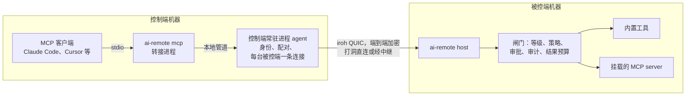

# ai-remote 架构

中文 | [English](architecture.md)

> 状态：预览阶段（pre-alpha）。里程碑 M0（命令行、Windows 被控端、面向 AI 的 MCP 桥）正在开发。
> 标注「（规划中）」的部分尚未实现。

## 1. ai-remote 是什么

ai-remote 是一个开源的远程控制系统，**AI agent 是一等操作者**。人依然可以随时旁观、随时接管，
但被控机器对外的主要接口不是一路视频流，而是一组结构化、按权限分级、全程留痕的工具。

| 角色 | 平台 | 做什么 |
|---|---|---|
| **被控端（host）** | Windows、macOS（规划中） | 运行 `ai-remote host`，把本机能力（屏幕、输入、界面、shell、后台任务、挂载的 MCP server）以 MCP 工具的形式，通过端到端加密的点对点连接提供出去；按设备分级授权，高风险操作先问主人，所有调用写入审计日志。 |
| **控制端（controller）** | Windows、macOS、iOS（规划中） | 与被控端配对并操作它们。`ai-remote mcp` 让任何 MCP 客户端（Claude Code、Cursor、自建 agent）都能驱动所有已配对的被控端；给人用的 App 在后续里程碑。 |

iOS 只能做控制端：系统不允许第三方 App 控制它所在的这台设备。

## 2. 设计原则

1. **AI 是一等客户端。** 被控端原生说 MCP。优先用结构化界面（带元素引用的无障碍树）操作，鼠标键盘是兜底。
   截图会按模型需要缩放，并附带把坐标映射回屏幕所需的几何信息。
2. **人始终说了算。** 每台配对设备都有权限等级，高风险工具要主人确认，每次调用都有审计，主人可以随时撤销设备。
   没人能确认时，一律视为拒绝。
3. **按密钥拨号，不按 IP。** 设备身份是 Ed25519 密钥。连接是端到端加密的 QUIC，自动打洞，打不通时经加密中继转发。
   不用端口映射，不用 VPN。
4. **不依赖服务器。** 配对靠一次性票据。可选、可自建的账号服务（规划中）只负责分发设备密钥和授权，从不经手会话内容。
5. **能复用就不重写。** ai-remote 构建在持续维护的开源组件之上（见第 9 节），只写自己特有的部分：
   权限闸门、工具、MCP 桥和各端 App。

## 3. 系统总览



## 4. 身份、配对与权限等级

- **身份。** 被控端和控制端两个角色各有一把 Ed25519 密钥，存在用户的配置目录里（`identity.key`）。
  密钥由我们自己保管再交给传输层，所以将来即使更换传输库，设备 ID 也不变。
- **配对。**
  1. 在被控端执行 `ai-remote pair-code --level control`，生成一张一次性票据（一天内有效）。
     全新的被控端启动时会自动打印一张。
  2. 在控制端执行 `ai-remote pair <票据> --name office-pc`。
  3. 两边会显示同样的三个英文单词作为安全码，人工核对一致即可，用来防止票据被调包。
- **权限等级**（由低到高）：

  | 等级 | 允许的操作 |
  |---|---|
  | `observe` | 系统信息、截图、窗口列表、界面树 |
  | `control` | 再加鼠标、键盘、切换窗口、剪贴板、界面操作 |
  | `admin` | 再加 shell、后台任务、文件 |

  `ai-remote level <设备> admin` 修改等级，下一次调用即生效，正在进行的会话也一样。
  `ai-remote revoke <设备>` 拒绝该设备，并立即切断它的所有在线连接。

## 5. 传输与线上协议

- **传输层。** [iroh](https://github.com/n0-computer/iroh) 的 QUIC，通过内嵌的
  [mcpmesh](https://github.com/counterpunchtech/mcpmesh) 节点提供配对、每条连接默认拒绝的闸门和撤销。
  这些全部收在 `ar-net` 一个 crate 后面，其他代码都不直接依赖 mcpmesh。
- **ALPN `app/ai-remote/mcp/1`。** 每个 MCP 会话一条双向流，按行分隔的 JSON-RPC，和 MCP 的 stdio
  分帧完全一致。控制端是 MCP 客户端，被控端是服务端。控制端对每台被控端只保持一条连接，每个会话开一条流。
- **中继。** 默认使用 n0 的公共中继（只能看到密文）；也可以在 `[network] relays = [...]`
  里配置自建的 [iroh-relay](https://github.com/n0-computer/iroh)。
- （规划中）`app/ai-remote/screen/1` 给人看的实时画面，`app/ai-remote/file/1` 用于大文件传输。

## 6. 闸门

每一次工具调用，不论是内置工具还是挂载工具，在被控端都走同一条流水线：

1. **等级**：调用方当前的等级必须够得上该工具的等级。
2. **策略**：按顺序匹配 `ai-remote.toml` 里的规则，第一条命中的生效；都不命中就用工具自身的默认值
   （observe、control 级直接执行，admin 级先询问）。挂载 server 自带的工具标注只作参考，不作为依据。
3. **审批**：策略为 `ask` 时，在被控端桌面弹出原生对话框，显示是谁、要调用哪个工具、给出的理由和参数。
   超时没人回答、桌面已锁定、机器无人值守，都按**拒绝**处理。
4. **审计**：调用前记一条（决策），调用后记一条（结果、耗时、大小、错误），参数只记 BLAKE3 哈希和截断预览。
5. **执行**：受会话生命周期约束；控制端断开或被撤销时，调用会被取消，子进程连同整棵进程树一起结束。
6. **结果预算**：超长文本只保留开头和结尾，并注明省略了多少字符，避免一次结果撑爆 agent 的上下文。

```toml
# ai-remote.toml（被控端）
[host]
name = "office-pc"
approval_timeout_secs = 60

[[rule]]
tool = "shell"
action = "ask"

[[rule]]
tool = "*"
principal = "build-bot"
action = "deny"
```

## 7. 被控端工具（M0）

| 工具 | 等级 | 作用 |
|---|---|---|
| `system_info` | observe | 操作系统、显示器、会话状态（是否交互会话、是否在控制台、是否锁屏、是否管理员）、你的等级 |
| `doctor` | observe | 分级体检，给出原因和修复办法（开发中） |
| `screenshot` | observe | 截取一块显示器，缩放（默认 1280 像素），返回图片和几何信息（开发中） |
| `zoom` | observe | 按原始分辨率放大截图中的某个区域（开发中） |
| `list_windows` | observe | 顶层窗口：所属程序、进程号、位置、是否前台（开发中） |
| `focus_window` | control | 把某个窗口切到前台（开发中） |
| `mouse` | control | 按截图坐标移动、点击、拖拽、滚动（开发中） |
| `keyboard` | control | 输入文字、按键和组合键（开发中） |
| `clipboard_read` / `clipboard_write` | control | 读写文本剪贴板（开发中） |
| `shell` | admin，需确认 | 带超时执行命令，超时或取消时结束整棵进程树 |
| `jobs_*` | admin | 带日志的后台任务：查看、等待、结束（开发中） |
| `<挂载名>_<工具>` | 按白名单 | 挂载 MCP server 的工具（开发中） |

坐标约定：`screenshot` 返回一个截图 ID；`mouse` 接收该截图里的像素坐标，由被控端换算成屏幕坐标。
模型不需要处理 DPI 缩放和多显示器偏移。

### 挂载 MCP server

被控端可以把本机的 MCP server 作为子进程启动，并只把**白名单**里的工具经过闸门暴露出去，命名为
`<挂载名>_<工具>`。ai-remote 就是靠这个复用现成成果，而不是重写一遍：默认的无障碍能力来自
[cua-driver](https://github.com/trycua/cua)（MIT 许可），它在 Windows 和 macOS 上提供元素级的界面操作。
上游新版本新增的工具，在加入白名单前一律隐藏；每次启动前都会校验可执行文件的 SHA-256。

```toml
[[mount]]
name = "ui"
command = "C:/Users/me/AppData/Local/ai-remote/data/host/mounts/cua-driver/cua-driver.exe"
args = ["mcp"]
sha256 = "..."
[mount.tools]
get_window_state = "observe"
click = "control"
launch_app = { level = "control", approve = "ask" }
```

## 8. 进程模型与平台规则

- **被控端必须跑在已登录用户的交互会话里，不能做成系统服务。** Windows 的服务运行在 0 号会话，那里没有桌面：
  截图全黑，输入没有去处，审批框也弹不出来。`ai-remote host install`（开发中）会注册一个登录时启动的计划任务，
  以最高权限和交互式令牌运行被控端；同时预先建好防火墙放行规则，免得首次监听时弹出一个无人处理的提示。
  macOS 上对应的是用户级 LaunchAgent（规划中）。
- **会话状态如实上报，不靠猜。** `system_info` 和 `doctor` 会说明进程是否在交互会话、是否在控制台、
  是否以管理员运行、桌面是否已锁定，让 agent 分得清是「我看不见」还是「屏幕上本来就没东西」。
- **DPI。** Windows 被控端开启了逐显示器 DPI 感知，截图、界面坐标和输入共用同一套物理像素坐标。
- **控制端进程模型。** `ai-remote agent` 是每个用户一个的常驻进程，持有控制端身份，并对每台被控端保持一条连接。
  `ai-remote mcp` 是 MCP 客户端启动的轻量转接进程：需要时自动拉起 agent，再把 stdio 转发过去。
  多个转接进程共用同一个 agent。本地管道只允许本人连接，而且不依赖半关闭（Windows 命名管道不会传递半关闭）。
- **配置目录。** 所有状态都在用户的配置目录里（可用 `--home` 或 `AI_REMOTE_HOME` 改到别处），
  方便在一台机器上同时跑多个身份做测试。

## 9. 复用了哪些组件

| 需求 | 组件 | 许可证 |
|---|---|---|
| 点对点 QUIC、打洞、中继 | iroh（n0） | MIT / Apache-2.0 |
| 配对、闸门、撤销、本地管道 | mcpmesh-node（锁定版本，见下文） | MIT / Apache-2.0 |
| MCP 协议 | rmcp（官方 Rust SDK） | Apache-2.0 |
| 截屏 | xcap | Apache-2.0 |
| 输入模拟 | enigo | MIT |
| 图片缩放与编码 | image | MIT / Apache-2.0 |
| 进程树管理 | process-wrap | MIT / Apache-2.0 |
| 原生对话框 | rfd | MIT |
| 系统信息 | sysinfo | MIT |
| 无障碍树（挂载） | cua-driver | MIT |

mcpmesh 0.58.0 锁定了 iroh 1.2、rmcp 3.1，以及一个已被作者撤回的 iroh-blobs 0.103.0。ai-remote 使用的
fork 只改了这三个版本号（iroh 1.3.0、rmcp 3.5.1、iroh-blobs 0.103.1），mcpmesh 自带的测试全部原样通过。
如果 mcpmesh 停止维护，可以直接在 iroh 上重写 `ar-net`，其余代码不受影响。

## 10. 代码结构

```
crates/
  ar-core/        配置目录布局、设备密钥、权限等级、被控端配置、结果预算
  ar-net/         传输层封装（mcpmesh + iroh）、本地进程间通信
  ar-host/        被控端：闸门、审批、审计、MCP 服务、工具、挂载、平台信息
  ar-controller/  agent、聚合 MCP 服务、stdio 转接
  ai-remote/      `ai-remote` 命令行
docs/
assets/brand/     Logo、横幅、演示动画
```

## 11. 里程碑

| 里程碑 | 范围 |
|---|---|
| **M0**（当前） | 命令行；Windows 被控端（屏幕、输入、剪贴板、shell、后台任务、挂载与闸门）；面向 agent 的 MCP 桥；登录自启安装；体检 |
| M1 | macOS 被控端（ScreenCaptureKit、无障碍、LaunchAgent）、文件传输、交互式终端、密钥存入系统钥匙串、真实桌面上的 CI |
| M2 | 给人看的实时画面（`screen/1`）、带审批和「AI 正在操作」提示的桌面 App |
| M3 | iOS 控制端 App（SwiftUI + 通过 UniFFI 复用 Rust 核心），上架 App Store |
| M4 | 可选、可自建的账号服务与中继，设备共享 |
