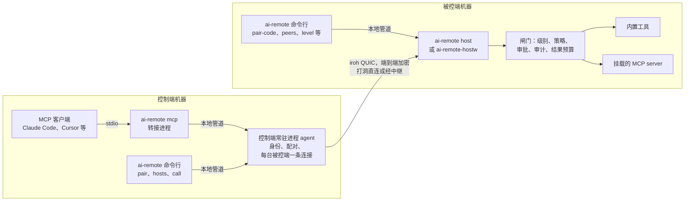

# ai-remote 架构

中文 | [English](architecture.md)

> 状态：Pre-alpha 阶段。M0 的范围（命令行、Windows 被控端、MCP 桥接）已在 main 分支实现，
> 但还没有发布任何版本，命令也可能调整。标注“（规划中）”的部分尚未实现。
>
> 本页是总览。被控端和控制端的部署与日常运维见 [operations.zh-CN.md](operations.zh-CN.md)；
> 每个工具的参数和各类配置格式见 [tools.zh-CN.md](tools.zh-CN.md)。

## 1. ai-remote 是什么

ai-remote 是一个开源的远程控制系统，**AI Agent 是一等操作者**。人依然可以随时旁观、随时接管，
但被控机器对外的主要接口不是一路视频流，而是一组结构化、按权限分级、全程留痕的工具。

| 角色 | 平台 | 做什么 |
|---|---|---|
| **被控端（host）** | Windows、macOS（规划中） | 在终端里运行 `ai-remote host`，或者登录后由 `ai-remote-hostw` 在后台运行。把本机能力（屏幕、输入、窗口、剪贴板、shell、后台任务、挂载的 MCP server）以 MCP 工具的形式，通过加密的点对点连接提供出去；按设备分级授权，高风险操作先问机主，所有调用写入审计日志。 |
| **控制端（controller）** | Windows、macOS、iOS（规划中） | 与被控端配对并操作它们。`ai-remote mcp` 让任何 MCP 客户端（Claude Code、Cursor、你自己写的 Agent）都能驱动所有已配对的被控端；给人用的应用会在后续里程碑推出。 |

iOS 只能做控制端：系统不允许第三方应用控制它所在的这台设备。

## 2. 设计原则

1. **AI 是一等客户端。** 被控端原生支持 MCP（Model Context Protocol）。优先用结构化界面操作
   （来自挂载的 server，例如 cua-driver 提供的带元素引用的无障碍界面树），鼠标键盘是兜底。
   截图会按模型需要缩放，并附带把坐标映射回屏幕所需的几何信息。
2. **人始终说了算。** 每台配对设备都有权限级别，高风险工具要机主审批，每次调用都有审计，机主可以随时撤销设备。
   没人能确认时，一律视为拒绝。
3. **按密钥拨号，不按 IP。** 设备身份是 Ed25519 密钥。连接是端到端加密的 QUIC，自动打洞穿透 NAT，
   打不通时经加密中继转发。不用端口映射，不用 VPN。
4. **不依赖服务器。** 配对靠一次性票据。可选、可自建的账号服务（规划中）只负责分发设备密钥和授权，从不经手会话内容。
5. **能复用就不重写。** ai-remote 构建在持续维护的开源组件之上（见第 9 节），只写自己特有的部分：
   闸门、工具、MCP 桥接和各端应用。

## 3. 系统总览



本地管道在 Windows 上是只有本人能打开的命名管道，在其他系统上是权限为 0600 的 Unix socket；
每个角色、每个配置目录各一个。

## 4. 身份、配对与权限级别

- **身份。** 被控端和控制端两个角色各有一把 Ed25519 密钥，存在用户的配置目录里（`identity.key`）。
  密钥由 ai-remote 自己保管，再交给传输层，所以将来即使更换传输库，设备 ID 也不变。
- **配对。**
  1. 在被控端执行 `ai-remote pair-code --level control`，向正在运行的被控端要一张一次性票据，24 小时后过期。
     在终端里启动、且还没有任何配对的被控端会自己打印一张；后台被控端从不打印，因为票据就是凭证，不该出现在日志里。
  2. 在控制端执行 `ai-remote pair <票据> --name office-pc`。它会打印由三个英文单词组成的安全码，以及被控端授予的级别。
  3. 被控端会显示同样的三个词：终端里会打印，日志里也一定会记下。对不上就说明票据被别人先兑换了，
     机主用 `ai-remote forget <控制端>` 把那台设备删掉即可。

  票据里带着被控端的公钥，所以控制端只能连到这台被控端；传输层会认证双方，所以被控端拿到的是控制端真实的公钥。
- **权限级别**（由低到高）：

  | 级别 | 允许的操作 |
  |---|---|
  | `observe` | 系统信息、体检、截图、放大截图、窗口列表 |
  | `control` | 再加鼠标、键盘、切换窗口、剪贴板、挂载 server 的界面操作 |
  | `admin` | 再加 shell 和后台任务（文件功能规划中） |

- **机主的控制命令**（在被控端执行；立即生效，正在进行的会话也一样）：

  | 命令 | 效果 |
  |---|---|
  | `ai-remote level <设备> <级别\|none>` | 修改级别，下一次调用就按新级别检查 |
  | `ai-remote revoke <设备>` | 从此拒绝这台设备（即使它拿到新票据也不行），并切断它的在线连接；配对记录保留 |
  | `ai-remote unrevoke <设备>` | 解除撤销（配对已删除时用设备 ID） |
  | `ai-remote forget <设备>` | 删除配对并切断在线连接；这台设备只能凭新票据重新配对 |

  各命令的细节，包括控制端在每种情况下会收到什么提示，见
  [operations.zh-CN.md](operations.zh-CN.md#6-权限级别与访问控制)。

## 5. 传输与通信协议

- **传输层。** [iroh](https://github.com/n0-computer/iroh) 的 QUIC，通过内嵌的
  [mcpmesh](https://github.com/counterpunchtech/mcpmesh) 节点提供配对、每条连接默认拒绝的闸门和撤销。
  这些全部收在 `ar-net` 一个 crate 后面，其他代码都不直接依赖 mcpmesh。
- **ALPN `app/ai-remote/mcp/1`。** 每个 MCP 会话一条双向流，按行分隔的 JSON-RPC，和 MCP 的 stdio
  分帧完全一致。控制端是 MCP 客户端，被控端是服务端。控制端对每台被控端只保持一条连接，每个会话开一条流。
- **拒绝连接。** 被控端不愿为某台设备服务时，会带着错误码和原因关闭连接：未知或已撤销的设备由传输层返回 401，
  “未配对”和“没有权限级别”由被控端返回 403，被控端退出时用 0。控制端把这些翻译成直白的说明并附上解决办法
  （`access revoked by the host`、`not paired`、`no access level`，以及附带原始原因的
  `host offline or unreachable`）。只有人能解除的拒绝，控制端不会反复重拨。它还会在常驻进程运行期间记住
  “被撤销”这件事，因为之后再拨号只会碰到闸门统一的 401（常驻进程重启后，被撤销的控制端看到的是 `not paired`）。
  需要机主处理时，提示里会带上控制端的设备 ID。完整列表见
  [operations.zh-CN.md](operations.zh-CN.md#7-被控端拒绝了怎么办)。
- **调用中途断线。** 调用执行期间连接断了，绝不会重发：请求可能已经在被控端执行过了，所以会如实告诉 Agent
  结果未知。开启会话没有副作用，所以在复用的连接上开会话失败、或 8 秒内没有响应时，会换一条新连接重试一次
  （被控端明确拒绝了这台设备时除外）。
- **中继与连通。** 默认使用 n0 的公共中继（只能看到密文）；被控端和控制端都可以通过 `[network] relays = [...]` 改用自建的
  [iroh-relay](https://github.com/n0-computer/iroh)，并默认保留 n0 中继作兜底。局域网（mDNS）发现、中继连接走 HTTP 代理
  （从环境变量或系统设置识别）、拨号重试都默认开启，见 [operations.zh-CN.md](operations.zh-CN.md#12-跨网络连接)。
  控制端会报告每条连接的线路（`path`、`relay`、`relay_n0`），P2P 失败时各端都会提示。
- **ALPN `app/ai-remote/events/1`。** 活动流和审批通道。控制端每个请求开一条流、写一行 JSON：
  `{"subscribe":true}` 返回被控端最近的审计记录，之后是每条新记录（工具的决策和结果、会话、审批），
  `ai-remote watch` 和应用把它变成 Agent 的操作时间线；`pending`、`answer`、`enroll`、`approver_status`
  用于远程审批（见 [approvals.zh-CN.md](approvals.zh-CN.md#通信格式)）；`turn`（接管、交还、暂停、恢复）和
  `tell`（给 Agent 的留言）用于轮流操作；`access`（本设备的级别、与它有关的规则、管理级别可见的已配对设备、
  可用的工具）、`lower`（降低自己的级别，不能提升）和 `leave`（自己解除配对）供应用的“访问权限”和“工具”标签页使用。
  改变设备自身权限的操作在回复发出之后才执行，因为授权一变，传输层就会切断该设备的连接。活动流的 hello 行带有
  该设备当前的级别。
- **ALPN `app/ai-remote/screen/1`。** 给控制端前的人看的被控端实时画面（桌面应用的会话画面；排查时用
  `ai-remote view`）。采集只在屏幕变化时给出一帧，最新的一帧放在只有一格的缓冲里，网络慢时在编码前就跳过旧帧。
  Windows：Windows Graphics Capture 跑在被控端自建的 D3D11 设备上，GPU 缩放并转 NV12，Media Foundation
  硬件编码（H.264、HEVC、AV1），OpenH264 兜底。macOS 13+：ScreenCaptureKit 加 VideoToolbox H.264。
  观看端列出自己能硬解的编码（桌面端 WebCodecs，iPhone VideoToolbox），被控端选第一个能编的。每帧是 18 字节
  帧头（类型、标志位含关键帧和编码、尺寸、按流时钟的采集时间戳、长度）加编码数据。观看端可以在自己那半条流上写
  控制行：请求关键帧、ping（被控端回流时钟，观看端据此显示"采集→显示"延迟）、改码率（桌面端按这个延迟随网络
  自适应）、请求单独发送光标（`"cursor":"client"`：发位置和形状消息，不再画进画面；目前只有 Windows 被控端）。
  任何有权限级别的设备都能看，观看会写入审计（`view_start`、`view_end`）。线上格式见
  `crates/ar-host/src/stream/protocol.rs`，画质配置和实测范围见[性能说明](stream-performance.md)。
- **ALPN `app/ai-remote/file/1`。** 整个文件的传输（`ai-remote push` / `pull`）。字节不经过 MCP（MCP 结果约 1 MiB
  封顶）：先调用 `files_push` / `files_pull` 工具，它和其他工具一样过闸门（级别、策略、审批、审计），返回一张
  一次性票据，绑定签发给的设备、路径，上传还绑定获批的大小和 SHA-256，2 分钟内有效；控制端再在这个 ALPN 上
  开一条流，写一行 `{"ticket":..}`，被控端回一行（`op`、`size`）后开始传字节。上传先写到目标旁的临时文件，
  大小和 SHA-256 都对上才原子替换；下载在字节后附一行 SHA-256 供控制端核对。双方都按事先知道的大小读写，
  不依赖对方关闭半条流。兑换时再查一次级别（须为 admin）和轮次（接管、暂停会中途停下传输）；每次传输都写一条
  审计记录（`transfer`）。MCP 客户端的工具列表里没有这两个签票工具（它们拿到票据也用不了）。

## 6. 闸门

每一次工具调用，不论是内置工具还是挂载工具，在被控端都走同一条流水线：

1. **级别与轮次**：每次调用都重新读取调用方的级别，必须够得上工具要求的级别。超出调用方级别的工具，
   也不会出现在它拿到的工具列表里。有人接管或暂停了 Agent 时，Agent 的调用会被拒绝，并附一句说明
   （见 [operations.zh-CN.md](operations.zh-CN.md#93-接管暂停和给-agent-留言)）。机主设为 bypass 的控制端
   （只能在被控端设置）按 admin 检查，并跳过第 2、3 步（见 [operations.zh-CN.md](operations.zh-CN.md#61-bypass完全信任某台控制端)）。
2. **策略**：按顺序匹配 `ai-remote.toml` 里的规则，第一条命中的生效；都不命中就用工具自身的默认动作
   （observe、control 级直接执行，admin 级先询问，只读取或停止后台任务的那几个 job 工具除外）。
   挂载 server 自带的工具标注只作参考，从不作为依据。
3. **审批**：动作为 `ask` 时由人来决定：可以在被控端桌面的原生对话框里（显示是谁、要调用哪个工具、给出的理由和参数），
   也可以在被控端接受了其审批密钥的已配对设备上，允许时必须用 Windows Hello（Touch ID、Face ID）对这一次调用签名
   （见 [approvals.zh-CN.md](approvals.zh-CN.md)）。先到的回答生效。截止前没人回答、或者没有人能回答，都按**拒绝**处理。
   对话框开着的时候，所有鼠标和键盘调用一律拒绝。
4. **审计**：调用执行前，先写一条 JSONL 格式的决策记录。
5. **执行**：受会话生命周期约束。控制端断开、被撤销或取消请求时，调用随之取消，子进程连同整棵进程树一起结束，
   挂载的 server 会收到 `notifications/cancelled`。
6. **结果预算**：超过 60,000 个字符的文本只保留开头和结尾，并注明省略了多少；过大的结构化内容直接丢弃
   （保留其文本形式）；图片控制在模型 API 能接受的范围内。这样一次结果撑不爆 Agent 的上下文。
7. **审计**：再写一条结果记录（耗时、经预算处理后的大小、错误）。两条记录都带参数的 BLAKE3 哈希；
   可能含机密的值（环境变量的值、标准输入、剪贴板文本）在审批框和日志里都只显示长度。

被拒绝的调用会返回一个带 `isError` 的工具结果，用一句话说明该怎么办；Agent 会被告知不要自动重试被拒绝或被否决的调用。

```toml
# ai-remote.toml（被控端），被控端启动时读取
[host]
name = "office-pc"
approval_timeout_secs = 60
approval_prompt = true      # false：只在审批设备上审批

[[rule]]
tool = "shell"
action = "ask"

[[rule]]
tool = "*"
principal = "build-bot"
action = "deny"
```

规则格式见 [tools.zh-CN.md](tools.zh-CN.md#8-策略规则)。

## 7. 被控端工具（M0）

| 工具 | 级别 | 作用 |
|---|---|---|
| `system_info` | observe | 操作系统、显示器、会话状态（是否交互会话、是否在控制台、是否锁屏、是否提升权限）、你的级别 |
| `doctor` | observe | 分级体检（ok、warn、fail），给出原因和修复办法 |
| `screenshot` | observe | 截取一块显示器并缩小（默认长边 1280 像素），返回图片和几何信息 |
| `zoom` | observe | 对之前某张截图中的一块区域，按原始分辨率重新截取 |
| `list_windows` | observe | 顶层窗口：所属程序、进程号、位置、所在显示器、是否有焦点、是否为浮层 |
| `focus_window` | control | 把某个窗口切到前台，并如实报告 Windows 是否允许 |
| `mouse` | control | 移动、点击（单击、双击、三击、右键、中键）、拖拽、滚动 |
| `keyboard` | control | 输入文字，按键、组合键和按键序列 |
| `clipboard_read` / `clipboard_write` | control | 读写文本剪贴板（读也要 `control`：剪贴板里常有机密） |
| `shell` | admin，需审批 | 带超时执行一条命令直到结束；调用结束时整棵进程树一起结束 |
| `jobs_start` | admin，需审批 | 启动一个后台命令，输出写入日志文件，会话结束后继续运行 |
| `jobs_status` / `jobs_log` / `jobs_wait` / `jobs_kill` | admin | 查看、等待和停止后台任务 |
| `files_list` / `files_stat` | admin | 列文件夹、查看路径 |
| `files_mkdir` / `files_delete` | admin，需审批 | 建文件夹、删除路径（拒绝根目录和被控端配置目录） |
| `files_push` / `files_pull` | admin，需审批 | 批准一次整文件传输，签发 `file/1` 的票据（仅命令行用） |
| `<挂载名>_<工具>` | 按白名单 | 挂载 MCP server 的工具 |

通过 `ai-remote mcp` 使用时，控制端还会加上 `list_hosts`、`use_host` 两个工具，并给每个被控端工具加一个
`host` 参数。每个工具的参数、返回值和限制见 [tools.zh-CN.md](tools.zh-CN.md)。

坐标约定：`screenshot` 返回一个截图 ID；`mouse` 接收该截图里的像素坐标，由被控端换算成屏幕坐标。
模型不需要处理 DPI 缩放和多显示器偏移。

### 输入安全

- 鼠标或键盘调用在发出第一个事件之前就会做完整校验（键名、坐标在截图内且落在某块显示器上、长度上限）。
- 每个事件发出前都要检查：会话还在、没有打开的审批框、桌面可用，而且目标窗口既不是被控端自己的窗口
  （审批框、被控端所在的终端），也不是权限更高的进程的窗口（Windows 会悄悄丢掉发给它的输入）。
- 会锁屏或注销的组合键（win+L、ctrl+alt+del）一律拒绝。
- 不管发生什么，调用按下的键和鼠标按钮都会在返回前全部松开；输入调用一次只执行一个。

### 挂载 MCP server

被控端可以把本机的 MCP server 作为子进程启动，并只把**白名单**里的工具经过闸门暴露出去，命名为
`<挂载名>_<工具>`。ai-remote 就是靠它复用现成的成果，而不是重写一遍：为
[cua-driver](https://github.com/trycua/cua)（MIT 许可）准备的预置配置，在 Windows 上提供元素级的界面操作。
server 后续版本新增的工具，加入白名单前一律隐藏；每次启动前都会校验可执行文件的 SHA-256；
崩溃或卡死的 server 会在下一次调用时按退避策略重启。

```toml
[[mount]]
name = "ui"
command = "C:/tools/cua-driver/cua-driver.exe"
args = ["mcp"]
sha256 = "<64 位十六进制>"
needs_desktop = true
[mount.tools]
get_window_state = "observe"
click = "control"
launch_app = { level = "control", approve = "ask" }
```

这些条目用 `ai-remote mount add`、`add-profile`、`test`、`list`、`remove` 管理。完整说明见
[tools.zh-CN.md](tools.zh-CN.md#7-挂载-mcp-server)。

## 8. 进程模型与平台规则

- **被控端运行在已登录用户的交互会话里，从不做成系统服务。** Windows 的服务运行在 0 号会话，那里没有桌面：
  截图全黑，输入没有去处，审批框也弹不出来。
- **进程。**

  | 进程 | 由谁启动 | 说明 |
  |---|---|---|
  | `ai-remote host` | 你，在终端里 | 消息打印在终端；还没有任何配对时打印一张配对票据 |
  | `ai-remote-hostw` | 登录时由自启项启动 | 没有控制台窗口，日志写到 `host/host.log`；在 Windows 上由一个小守护进程托管，被控端崩溃后自动重启 |
  | `ai-remote agent` | 命令行或 `ai-remote mcp`，按需启动 | 控制端常驻进程；空闲 30 分钟后自动退出 |
  | `ai-remote mcp` | MCP 客户端 | 很薄的 stdio 转接进程；多个转接进程共用一个常驻进程 |

  每个配置目录只运行一个被控端：再启动一个，会发现这个配置目录的控制管道已被占用，随即退出。
- **安装。** `ai-remote host install` 注册后台被控端：在 Windows 上是一个用户登录时触发、以最高权限和交互式令牌
  运行的计划任务，外加入站防火墙规则，免得首次监听时弹出一个没人处理的提示；在 macOS 上是用户级 LaunchAgent
  （macOS 被控端本身规划在 M1）。`--dry-run` 会先列出每一处改动。见
  [operations.zh-CN.md](operations.zh-CN.md#3-运行被控端)。
- **会话状态如实上报，不靠猜。** `system_info` 和 `doctor` 会说明进程是否在交互会话、是否在控制台、
  是否以管理员权限运行、桌面是否已锁定，让 Agent 分得清是“我看不见”还是“屏幕上本来就没东西”。
- **DPI。** Windows 被控端开启了逐显示器 DPI 感知（v2），截图、窗口位置和输入共用同一套物理像素坐标。
- **子进程。** 被控端启动的所有东西（shell 命令、后台任务、挂载的 server、系统工具）都不带控制台窗口；
  shell 命令和挂载的 server 会连同整棵进程树一起结束。后台任务是有意为之的例外：它们在会话结束后继续运行，
  被控端重启后会重新接管仍在运行的任务。但只有上层每一个作业对象（job object）都允许脱离，它们才能比被控端进程
  本身活得更久。Windows 后台被控端由任务计划程序启动，而任务计划程序的作业对象不允许脱离，所以它停止或重启时，
  它启动的后台任务也会结束；在终端里启动的被控端通常能让任务继续存活（见 [tools.zh-CN.md](tools.zh-CN.md#512-后台任务)）。
- **控制端进程模型。** `ai-remote agent` 持有控制端身份，并对每台被控端保持一条连接。`ai-remote mcp`
  是 MCP 客户端启动的进程：需要时自动拉起常驻进程，再把请求转发过去。本地管道不依赖半关闭
  （Windows 命名管道不会传递半关闭）。
- **配置目录。** 所有状态都在每个用户自己的配置目录里（可用 `--home` 或 `AI_REMOTE_HOME` 改到别处），
  方便在一台机器上同时跑多个身份做测试。

## 9. 复用了哪些组件

| 需求 | 组件 | 许可证 |
|---|---|---|
| 点对点 QUIC、打洞、中继 | iroh（n0） | MIT / Apache-2.0 |
| 配对、闸门、撤销、本地管道 | mcpmesh-node（锁定版本，见下文） | MIT / Apache-2.0 |
| MCP 协议 | rmcp（官方 Rust SDK） | Apache-2.0 |
| 截屏、窗口列表 | xcap | Apache-2.0 |
| 输入模拟 | enigo | MIT |
| 剪贴板 | arboard | MIT / Apache-2.0 |
| 图片缩放与编码 | image | MIT / Apache-2.0 |
| 进程树管理 | process-wrap | MIT / Apache-2.0 |
| 原生对话框 | rfd | MIT |
| 系统信息 | sysinfo | MIT |
| 防火墙规则（读取） | windows_firewall | MIT / Apache-2.0 |
| 日志轮转 | file-rotate | MIT |
| 无障碍界面树（挂载） | cua-driver | MIT |

mcpmesh 0.58.0 锁定了 iroh 1.2、rmcp 3.1，以及一个已被作者撤回的 iroh-blobs 0.103.0。ai-remote 固定在仓库中的补丁副本 只改了这三个版本号（iroh 1.3.0、rmcp 3.5.1、iroh-blobs 0.103.1），mcpmesh 自带的测试全部原样通过。[源码来源](../vendor/mcpmesh/README.ai-remote.md)保留了版本、散列与许可证，构建不需要私有 Git 权限。
如果 mcpmesh 停止维护，可以直接在 iroh 上重写 `ar-net`，其余代码不受影响。

## 10. 代码结构

```
crates/
  ar-core/        配置目录布局、设备密钥、权限级别、被控端配置、结果预算
  ar-net/         传输层封装（mcpmesh + iroh）、拒绝原因、本地进程间通信
  ar-host/        被控端：闸门、审批、审计、MCP 服务、工具、挂载、体检、
                  安装（登录自启 + 防火墙）、平台信息
    profiles/     挂载预置配置（cua-driver）
  ar-controller/  常驻进程 agent、聚合 MCP 服务、stdio 转接
  ai-remote/      `ai-remote` 命令行，以及无窗口的 `ai-remote-hostw`
docs/
assets/brand/     Logo、横幅、演示动画
```

## 11. 里程碑

| 里程碑 | 范围 |
|---|---|
| **M0**（已实现，尚未发布） | 命令行；Windows 被控端（屏幕、输入、剪贴板、shell、后台任务、挂载与闸门）；面向 Agent 的 MCP 桥接；登录自启安装；体检 |
| M1 | macOS 被控端（ScreenCaptureKit、无障碍、LaunchAgent）、文件传输、交互式终端、密钥存入系统密钥库、真实桌面上的 CI |
| M2 | 给人看的实时画面（`screen/1`）、带审批和“AI 正在操作”提示的桌面应用 |
| M3 | iOS 控制端应用（SwiftUI 界面，通过 UniFFI 复用 Rust 核心），上架 App Store |
| M4 | 可选、可自建的账号服务与中继，设备共享 |
